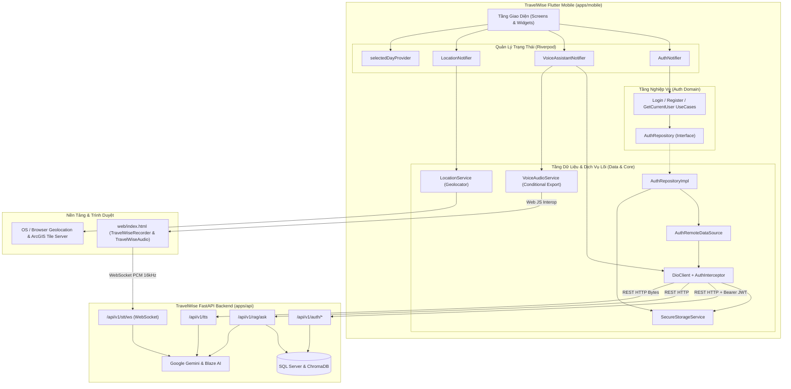
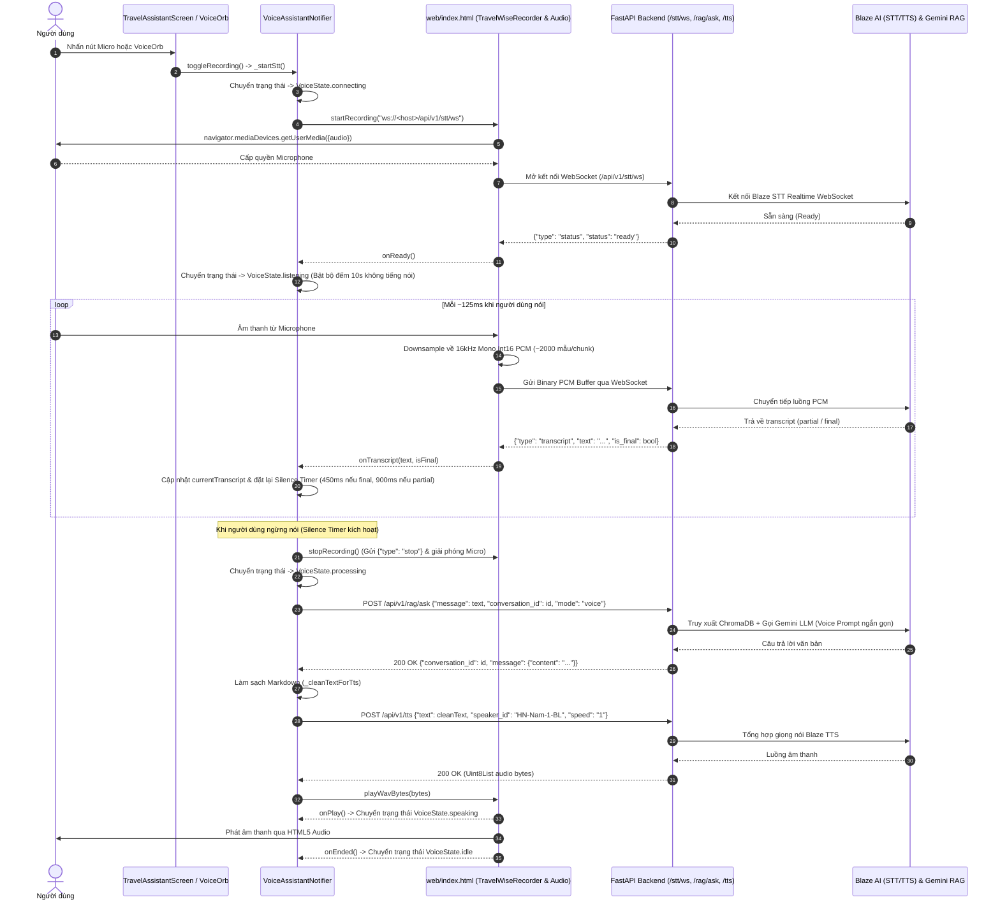
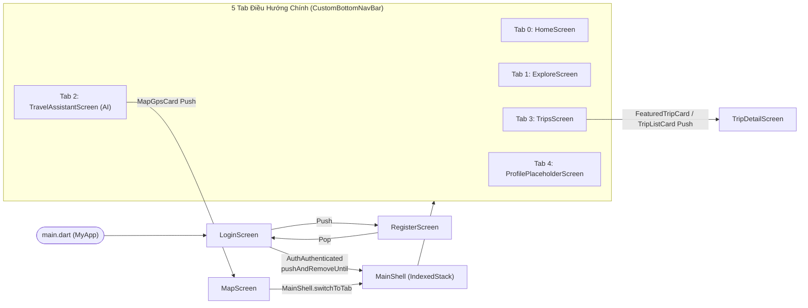

# TravelWise Mobile — Ứng Dụng Du Lịch Thông Minh (Flutter)

**TravelWise Mobile** là ứng dụng khách đa nền tảng (Cross-Platform Client) thuộc hệ sinh thái **TravelWise**, được phát triển bằng **Flutter** và **Dart**. Ứng dụng cung cấp giao diện người dùng cho việc xác thực tài khoản, khám phá điểm đến, tương tác với trợ lý du lịch AI (Chat & Voice Assistant tích hợp RAG), định vị GPS trên bản đồ số và theo dõi lịch trình chuyến đi.

Trong kiến trúc monorepo của TravelWise (`apps/api`, `apps/web`, `apps/mobile`), phân hệ `apps/mobile` đóng vai trò là lớp hiển thị và tương tác trực tiếp với người dùng cuối trên thiết bị di động và trình duyệt Web, kết nối tới **TravelWise FastAPI Backend** qua giao thức HTTP REST và WebSocket.

### Thông tin kỹ thuật tổng quan

- **Ngôn ngữ & SDK:** Dart SDK `>=3.10.0 <4.0.0`, Flutter (Material 3)
- **Quản lý trạng thái & DI:** `flutter_riverpod` (`^2.6.1`)
- **Giao tiếp mạng:** `dio` (`^5.7.0`), `web_socket_channel` (`^3.0.1`)
- **Bản đồ & Định vị:** `flutter_map` (`^8.3.2`), `latlong2` (`^0.10.1`), `geolocator` (`^13.0.2`), `google_maps_flutter` (`^2.10.0`)
- **Bảo mật lưu trữ:** `flutter_secure_storage` (`^9.2.4`)
- **Nền tảng có cấu hình trong dự án:** Android, Flutter Web (Chrome), iOS, Windows, macOS, Linux *(trong đó Android và Flutter Web được cấu hình chuyên sâu nhất cho các tính năng hiện tại)*.

---

## Mục Lục

1. [Tổng Quan Sản Phẩm (Product Overview)](#1-tổng-quan-sản-phẩm-product-overview)
2. [Hình Ảnh Giao Diện & Demo (Screenshots and Demo)](#2-hình-ảnh-giao-diện--demo-screenshots-and-demo)
3. [Công Nghệ Sử Dụng (Technology Stack)](#3-công-nghệ-sử-dụng-technology-stack)
4. [Kiến Trúc Hệ Thống (System Architecture)](#4-kiến-trúc-hệ-thống-system-architecture)
5. [Cấu Trúc Thư Mục Thực Tế (Project Directory Structure)](#5-cấu-trúc-thư-mục-thực-tế-project-directory-structure)
6. [Yêu Cầu Hệ Thống (System Requirements)](#6-yêu-cầu-hệ-thống-system-requirements)
7. [Cài Đặt & Chạy Môi Trường Local (Installation and Local Development)](#7-cài-đặt--chạy-môi-trường-local-installation-and-local-development)
8. [Cấu Hình Môi Trường (Environment Configuration)](#8-cấu-hình-môi-trường-environment-configuration)
9. [Tích Hợp Backend API (Backend API Integration)](#9-tích-hợp-backend-api-backend-api-integration)
10. [Kiến Trúc Trợ Lý AI & Tương Tác Giọng Nói (AI Assistant and Voice Architecture)](#10-kiến-trúc-trợ-lý-ai--tương-tác-giọng-nói-ai-assistant-and-voice-architecture)
11. [Bản Đồ, Định Vị GPS & Lập Kế Hoạch Chuyến Đi (Maps, GPS, and Trip Planning)](#11-bản-đồ-định-vị-gps--lập-kế-hoạch-chuyến-đi-maps-gps-and-trip-planning)
12. [Hệ Thống Điều Hướng & Thiết Kế Giao Diện (Navigation and UI Design System)](#12-hệ-thống-điều-hướng--thiết-kế-giao-diện-navigation-and-ui-design-system)
13. [Kiểm Thử & Chất Lượng Mã Nguồn (Testing and Code Quality)](#13-kiểm-thử--chất-lượng-mã-nguồn-testing-and-code-quality)
14. [Đóng Gói & Phát Hành (Build and Release)](#14-đóng-gói--phát-hành-build-and-release)
15. [Bảo Mật & Quyền Riêng Tư (Security and Privacy)](#15-bảo-mật--quyền-riêng-tư-security-and-privacy)
16. [Xử Lý Sự Cố Thường Gặp (Troubleshooting)](#16-xử-lý-sự-cố-thường-gặp-troubleshooting)
17. [Quy Trình Git & Đóng Góp Mã Nguồn (Git Workflow and Contribution Guidelines)](#17-quy-trình-git--đóng-góp-mã-nguồn-git-workflow-and-contribution-guidelines)
18. [Lộ Trình Phát Triển & Giới Hạn Hiện Tại (Roadmap and Known Limitations)](#18-lộ-trình-phát-triển--giới-hạn-hiện-tại-roadmap-and-known-limitations)
19. [Giấy Phép & Liên Hệ (License and Contact)](#19-giấy-phép--liên-hệ-license-and-contact)

---

## 1. Tổng Quan Sản Phẩm (Product Overview)

Dưới góc độ người dùng cuối, **TravelWise Mobile** được thiết kế nhằm hợp nhất trải nghiệm tra cứu thông tin du lịch, hỏi đáp AI và quản lý lịch trình trong một ứng dụng duy nhất.

Dựa trên mã nguồn thực tế tại `apps/mobile/lib/`, trạng thái triển khai của từng nhóm tính năng được phân loại minh bạch như sau:

| Phân hệ tính năng | Mô tả chức năng | Trạng thái triển khai thực tế |
|---|---|---|
| **Đăng ký & Đăng nhập (`auth`)** | Đăng ký tài khoản mới (`full_name`, `email`, `password`), đăng nhập nhận JWT token, lưu trữ bảo mật và lấy thông tin hồ sơ người dùng hiện tại (`/api/v1/auth/me`). | **Đã hoàn thiện tích hợp API** (theo mô hình Clean Architecture + Riverpod). Nút "Tiếp tục với Google" và "Quên mật khẩu?" hiện mới dừng ở mức giao diện (UI placeholder). |
| **Trợ lý AI & Voice (`assistant`)** | Trò chuyện văn bản và giọng nói với **Linh AI** (`TravelAssistantScreen`). Hỗ trợ nhận diện giọng nói thời gian thực (STT), hỏi đáp RAG (`/api/v1/rag/ask`) và phát giọng đọc AI (TTS qua `/api/v1/tts`). | **Đã tích hợp API cho Chat & Voice trên Flutter Web** (`voice_audio_web.dart` + JS Bridge). Trên nền tảng Native (Android/iOS), module thu âm/phát âm thanh hiện đang dùng bản stub (`voice_audio_stub.dart`). Một số thẻ trên màn hình như thông tin thời tiết header (`28°C`) và thẻ `Cà phê Trình Biển` là dữ liệu tĩnh. |
| **Bản đồ & Định vị GPS (`map`)** | Hiển thị bản đồ tương tác (`FlutterMap` với lớp nền ArcGIS World Street Map), kiểm tra/yêu cầu quyền vị trí có hộp thoại giải thích (in-app rationale), lấy tọa độ GPS độ chính xác cao (`Geolocator`), hiển thị vòng tròn sai số và thẻ tọa độ chi tiết. | **Đã hoàn thiện tích hợp GPS & Bản đồ**. Chức năng tìm kiếm địa điểm trên bản đồ (`MapSearchBar`) hiện chưa kết nối với endpoint tìm kiếm của backend. |
| **Trang chủ (`home`)** | Hiển thị lời chào, thanh tìm kiếm, gợi ý nhanh (chips), danh sách điểm đến thịnh hành, lưới danh mục, thẻ gợi ý lịch trình AI và địa điểm gần bạn. | **Giao diện tĩnh / Dữ liệu mẫu (Mock UI)**. Các thẻ hiển thị dữ liệu cứng nhằm minh họa bố cục thiết kế. |
| **Khám phá (`explore`)** | Tìm kiếm, lọc theo danh mục (Category Chips, Filter Row), xem điểm đến nổi bật (`FeaturedCard`) và danh sách địa điểm quanh bạn (`PlaceCard`). | **Giao diện tĩnh / Dữ liệu mẫu (Mock UI)**. Danh sách địa điểm hiện được khởi tạo cục bộ trong `ExploreScreen`. |
| **Quản lý chuyến đi (`trips`)** | Xem danh sách chuyến đi, lọc theo trạng thái (`all`, `upcoming`, `planning`, `draft`, `completed`), tìm kiếm cục bộ theo tên/điểm đến, xem chi tiết lịch trình từng ngày (`TripDetailScreen`) theo dòng thời gian (`ItineraryTimeline`). | **Giao diện tương tác trên dữ liệu mẫu (`mockTripsList`)**. Đã có bộ lọc, tìm kiếm trên bộ nhớ và chuyển đổi ngày (`selectedDayProvider`), nhưng chưa gọi API `/api/v1/trips` từ backend. |
| **Thông tin thời tiết (`weather`)** | Cung cấp thông tin thời tiết theo tọa độ hoặc địa điểm. | **Tích hợp gián tiếp qua RAG Backend**. Mobile chưa có màn hình Weather độc lập gọi trực tiếp `/api/v1/weather`, nhưng câu hỏi thời tiết gửi qua `POST /api/v1/rag/ask` được backend tự động trích xuất ngữ cảnh từ Open-Meteo. |
| **Hồ sơ cá nhân (`profile`)** | Quản lý thông tin tài khoản người dùng trên thanh điều hướng chính. | **Đang lên kế hoạch (Placeholder)**. Tab thứ 5 trong `MainShell` hiện hiển thị màn hình giữ chỗ `ProfilePlaceholderScreen`. |

---

## 2. Hình Ảnh Giao Diện & Demo (Screenshots and Demo)

Qua kiểm tra thư mục tài nguyên (`apps/mobile/assets/images/` chỉ chứa `google.png` và thư mục `docs/`), dự án hiện **chưa lưu trữ ảnh chụp màn hình (screenshots) hoặc video demo** của ứng dụng Flutter trong kho mã nguồn.

### Hướng dẫn bổ sung ảnh chụp màn hình sau này

Khi nhóm phát triển cập nhật hình ảnh minh họa, khuyến nghị lưu tại thư mục `apps/mobile/docs/screenshots/` (đường dẫn tương đối từ thư mục `apps/mobile`) và nhúng vào bảng dưới đây:

```markdown
| Đăng nhập (`LoginScreen`) | Trang chủ (`HomeScreen`) | Trợ lý AI (`TravelAssistantScreen`) |
|---|---|---|
|  |  |  |

| Bản đồ GPS (`MapScreen`) | Danh sách chuyến đi (`TripsScreen`) | Chi tiết lịch trình (`TripDetailScreen`) |
|---|---|---|
|  |  |  |
```

---

## 3. Công Nghệ Sử Dụng (Technology Stack)

Bảng dưới đây liệt kê chính xác các thư viện và công nghệ được khai báo trong `apps/mobile/pubspec.yaml` và sử dụng trong mã nguồn:

| Thành phần | Công nghệ / Thư viện | Phiên bản (`pubspec.yaml`) | Trách nhiệm trong dự án |
|---|---|---|---|
| **Framework & SDK** | Flutter & Dart SDK | Dart `>=3.10.0 <4.0.0` | Nền tảng phát triển ứng dụng đa nền tảng |
| **UI & Design System** | Material 3 (`useMaterial3: true`) | Theo Flutter SDK | Hệ thống widget cốt lõi và bố cục giao diện |
| **Typography** | `google_fonts` | `^9.0.0` | Cung cấp phông chữ **Inter** toàn cục (`AppTextStyles`) |
| **Biểu tượng (Icons)** | `lucide_flutter` & `cupertino_icons` | `^1.0.0` / `^1.0.8` | Bộ icon hiện đại cho Auth, Trips, Explore và hệ thống |
| **State Management & DI** | `flutter_riverpod` | `^2.6.1` | Quản lý trạng thái (`StateNotifier`, `StateProvider`) và Dependency Injection (`Provider`) |
| **HTTP Networking** | `dio` | `^5.7.0` | HTTP client gọi REST API, quản lý timeout, đính kèm Bearer token và ghi log |
| **WebSocket** | `web_socket_channel` | `^3.0.1` | Khai báo cho kết nối thời gian thực *(lưu ý: STT trên Web hiện dùng `WebSocket` gốc của trình duyệt qua JS interop)* |
| **Lưu trữ bảo mật** | `flutter_secure_storage` | `^9.2.4` | Lưu trữ mã hóa `access_token` và `token_type` (`EncryptedSharedPreferences` trên Android, `Keychain` trên iOS) |
| **Serialization** | `json_annotation` / `json_serializable` | `^4.9.0` / `^6.9.0` | Ánh xạ dữ liệu JSON sang model Dart (`TokenModel`, `UserModel`) |
| **Xử lý lỗi hàm (FP)** | `dartz` | `^0.10.1` | Cung cấp kiểu `Either<Failure, T>` cho tầng Domain và Repository của module `auth` |
| **So sánh giá trị** | `equatable` | `^2.0.7` | So sánh giá trị cho các thực thể (`User`, `AuthToken`), `Failure` và `AuthState` |
| **Định dạng quốc tế hóa** | `intl` | `^0.20.3` | Định dạng ngày tháng lịch trình (`DateFormat` trong `FeaturedTripCard`) |
| **Bản đồ tương tác** | `flutter_map` & `latlong2` | `^8.3.2` / `^0.10.1` | Hiển thị bản đồ số (`MapScreen`), vòng tròn sai số GPS và đánh dấu vị trí |
| **Google Maps (Khai báo)** | `google_maps_flutter` / `_web` | `^2.10.0` / `^0.5.10` | Đã khai báo trong `pubspec.yaml` và `AndroidManifest.xml` *(hiện tại màn hình bản đồ chính đang dùng `flutter_map`)* |
| **Định vị GPS** | `geolocator` | `^13.0.2` | Kiểm tra dịch vụ GPS, xin quyền truy cập vị trí và lấy tọa độ phần cứng |
| **Xử lý âm thanh Web** | `dart:js_util` + Web Audio API | Tích hợp sẵn (Web) | Thu âm PCM 16kHz qua `TravelWiseRecorder` và phát âm thanh qua `TravelWiseAudio` (`web/index.html`) |
| **Kiểm thử & Phân tích mã** | `flutter_test`, `flutter_lints`, `build_runner` | SDK / `^6.0.0` / `^2.4.14` | Kiểm thử widget, phân tích tĩnh theo quy chuẩn Flutter và sinh mã nguồn tự động (`.g.dart`) |

---

## 4. Kiến Trúc Hệ Thống (System Architecture)

### 4.1. Tổng quan kiến trúc thực tế

Ứng dụng `apps/mobile` được tổ chức theo hướng **Feature-First (phân chia theo tính năng)** kết hợp với các thành phần dùng chung tại `core/` và `shared/`. Tuy nhiên, mức độ phân tầng bên trong từng feature không hoàn toàn đồng nhất mà phản ánh quá trình phát triển từng giai đoạn của dự án:

1. **Mô hình Clean Architecture đầy đủ (`features/auth/`):** Tách biệt rõ ràng 3 tầng `domain` (Entities, Repository Interfaces, UseCases) — `data` (Models JSON, RemoteDataSource, Repository Implementation) — `presentation` (Riverpod `StateNotifier`, `AuthState`, Screens, Widgets) cùng tệp cấu hình DI riêng (`auth_di.dart`).
2. **Mô hình Presentation + Core Service/Provider (`features/assistant/`, `features/map/`):** Tầng giao diện (`ConsumerWidget` / `ConsumerStatefulWidget`) lắng nghe trực tiếp các `StateNotifier` (`VoiceAssistantNotifier`, `LocationNotifier`). Các notifier này gọi xuống `DioClient` hoặc các dịch vụ nền tảng trong `core/` (`VoiceAudioService`, `LocationService`).
3. **Mô hình UI-Driven với dữ liệu cục bộ (`features/home/`, `features/explore/`, `features/trips/`):** Tập trung vào tầng hiển thị (`screens/`, `widgets/`) và các mô hình dữ liệu (`models/`), sử dụng `StateProvider` đơn giản (như `selectedDayProvider` trong `trips`) hoặc `StatefulWidget` để quản lý trạng thái lọc/tìm kiếm tại chỗ.

### 4.2. Sơ đồ kiến trúc và luồng dữ liệu



### 4.3. Giải thích ranh giới các tầng

- **Tầng Presentation (`screens/`, `widgets/`, `providers/`):** Chịu trách nhiệm hiển thị giao diện Material 3, nhận thao tác người dùng và phản ứng với các thay đổi trạng thái thông qua `ref.watch` và `ref.listen`.
- **Tầng Quản lý trạng thái & Dependency Injection:** Sử dụng `flutter_riverpod`. Điểm khởi chạy `main.dart` bọc toàn bộ ứng dụng trong `ProviderScope`. Các provider cốt lõi (`secureStorageProvider`, `dioClientProvider`) được định nghĩa tại `lib/features/auth/auth_di.dart` và được tái sử dụng bởi cả `AuthRemoteDataSource` lẫn `VoiceAssistantNotifier`.
- **Tầng Networking & Serialization (`core/network/dio_client.dart`):** Cung cấp `DioClient` với `BaseOptions` (`connectTimeout: 15s`, `receiveTimeout: 15s`, header `application/json`). Tự động đính kèm JWT thông qua `_authInterceptor()` và ghi nhận nhật ký HTTP qua `LogInterceptor`.
- **Tầng Tích hợp đa nền tảng (Platform Integration):**
  - **Âm thanh (`core/audio/`):** Sử dụng kỹ thuật *Conditional Export* trong `voice_audio_service.dart`:
    ```dart
    export 'voice_audio_stub.dart'
        if (dart.library.html) 'voice_audio_web.dart';
    ```
    Giúp mã nguồn biên dịch an toàn trên mọi nền tảng (Mobile/Desktop dùng bản stub, Web dùng bản giao tiếp JavaScript).
  - **Vị trí (`core/services/location_service.dart`):** Bọc thư viện `Geolocator` và trả về đối tượng `LocationResult` có cấu trúc rõ ràng, không phụ thuộc trực tiếp vào UI.
- **Cơ chế xử lý lỗi (`core/error/`):** Phân tách giữa ngoại lệ tầng dữ liệu (`ServerException`, `CacheException` trong `exceptions.dart`) và lỗi tầng nghiệp vụ (`Failure`, `ServerFailure`, `CacheFailure`, `NetworkFailure` trong `failures.dart`).

---

## 5. Cấu Trúc Thư Mục Thực Tế (Project Directory Structure)

Dưới đây là cấu trúc thư mục thực tế của `apps/mobile` (đã lược bỏ các thư mục sinh tự động như `.dart_tool/`, `build/`, `.gradle/`, `ephemeral/` và các tệp kịch bản tạm thời):

```text
apps/mobile/
├── android/                                # Cấu hình nền tảng Android (Gradle Kotlin DSL, Manifest)
│   ├── app/
│   │   ├── build.gradle.kts                # Cấu hình applicationId, SDK versions, Java 17
│   │   └── src/main/AndroidManifest.xml    # Khai báo quyền GPS và Google Maps API key metadata
│   └── build.gradle.kts
├── assets/
│   └── images/
│       └── google.png                      # Tài nguyên hình ảnh tĩnh
├── ios/                                    # Cấu hình nền tảng iOS (Xcode Runner, Info.plist)
├── lib/                                    # Mã nguồn Dart chính của ứng dụng
│   ├── core/                               # Các module hạ tầng dùng chung toàn ứng dụng
│   │   ├── audio/                          # Dịch vụ âm thanh đa nền tảng (Conditional export)
│   │   │   ├── voice_audio_service.dart    # Điểm xuất (export) tự động chọn stub hoặc web
│   │   │   ├── voice_audio_stub.dart       # Bản thay thế an toàn cho nền tảng non-web
│   │   │   └── voice_audio_web.dart        # Cầu nối JS interop gọi TravelWiseRecorder & TravelWiseAudio
│   │   ├── constants/                      # Hệ thống Token thiết kế (Design Tokens)
│   │   │   ├── colors.dart                 # Bảng màu chuẩn (AppColors)
│   │   │   ├── spacing.dart                # Khoảng cách & bo góc (AppSpacing, AppRadius)
│   │   │   └── text_styles.dart            # Kiểu chữ Google Fonts Inter (AppTextStyles)
│   │   ├── error/                          # Định nghĩa lỗi chuẩn hóa
│   │   │   ├── exceptions.dart             # ServerException, CacheException
│   │   │   └── failures.dart               # Failure, ServerFailure, CacheFailure, NetworkFailure
│   │   ├── network/
│   │   │   └── dio_client.dart             # ApiConfig, DioClient, Auth & Logging Interceptors
│   │   ├── services/
│   │   │   └── location_service.dart       # LocationService, LocationResult, LocationPermissionStatus
│   │   └── storage/
│   │       └── secure_storage_service.dart # Lưu trữ mã hóa JWT token bằng FlutterSecureStorage
│   ├── features/                           # Các phân hệ tính năng nghiệp vụ
│   │   ├── assistant/                      # Trợ lý ảo AI & Tương tác giọng nói (Linh AI)
│   │   │   └── presentation/
│   │   │       ├── providers/
│   │   │       │   └── voice_assistant_provider.dart # Quản lý trạng thái STT, RAG chat và TTS
│   │   │       ├── screens/
│   │   │       │   └── travel_assistant_screen.dart  # Màn hình chính của trợ lý AI
│   │   │       └── widgets/                # VoiceOrb, WaveformBars, TranscriptView, MapGpsCard, ...
│   │   ├── auth/                           # Xác thực người dùng (Clean Architecture)
│   │   │   ├── auth_di.dart                # Khai báo Riverpod Providers cho toàn bộ luồng Auth & Dio
│   │   │   ├── data/
│   │   │   │   ├── datasources/            # AuthRemoteDataSource (gọi /api/v1/auth/*)
│   │   │   │   ├── models/                 # TokenModel, UserModel và các tệp .g.dart
│   │   │   │   └── repositories/           # AuthRepositoryImpl
│   │   │   ├── domain/
│   │   │   │   ├── entities/               # AuthToken, User
│   │   │   │   ├── repositories/           # AuthRepository (abstract contract)
│   │   │   │   └── usecases/               # LoginUseCase, RegisterUseCase, GetCurrentUserUseCase
│   │   │   ├── presentation/               # Luồng giao diện Auth đang sử dụng chính
│   │   │   │   ├── providers/              # AuthNotifier, AuthState
│   │   │   │   ├── screens/                # LoginScreen, RegisterScreen
│   │   │   │   └── widgets/                # AuthTextField, AuthPrimaryButton
│   │   │   ├── screens/                    # Màn hình AuthScreen dạng TabBar (phiên bản UI phụ)
│   │   │   └── widgets/                    # Các widget phụ trợ cho AuthScreen
│   │   ├── explore/                        # Khám phá điểm đến & ẩm thực
│   │   │   ├── models/                     # Place model cục bộ
│   │   │   ├── screens/                    # ExploreScreen
│   │   │   └── widgets/                    # CategoryChips, FilterRow, FeaturedCard, PlaceCard, ...
│   │   ├── home/                           # Trang chủ ứng dụng
│   │   │   ├── models/                     # Place model cục bộ
│   │   │   ├── screens/                    # HomeScreen
│   │   │   └── widgets/                    # HeaderSection, DestinationCard, AiItineraryCard, ...
│   │   ├── map/                            # Bản đồ số & Định vị GPS
│   │   │   ├── data/services/              # Re-export LocationService từ core
│   │   │   └── presentation/
│   │   │       ├── providers/              # LocationNotifier, LocationState (và alias mapProvider)
│   │   │       ├── screens/                # MapScreen (FlutterMap + GPS controls)
│   │   │       └── widgets/                # CurrentLocationMarker, LocationInfoCard, PermissionDialog
│   │   └── trips/                          # Quản lý chuyến đi & Lịch trình chi tiết
│   │       ├── models/                     # Trip, TripDay, ItineraryActivity, mockTripsList
│   │       ├── providers/                  # selectedDayProvider
│   │       ├── screens/                    # TripsScreen, TripDetailScreen
│   │       └── widgets/                    # ItineraryTimeline, TripHeroHeader, overview widgets, ...
│   ├── shared/                             # Thành phần giao diện dùng chung giữa các features
│   │   └── widgets/
│   │       ├── bottom_nav_bar.dart         # Thanh điều hướng 5 tab (CustomBottomNavBar)
│   │       ├── floating_ai_bar.dart        # Thanh nổi gợi ý hỏi nhanh AI
│   │       └── main_shell.dart             # Khung điều hướng chính sau khi đăng nhập (MainShell)
│   ├── main.dart                           # Điểm khởi chạy ứng dụng (ProviderScope -> MyApp -> LoginScreen)
│   └── main_screen.dart                    # Khung màn hình thay thế (hiện không được gọi từ LoginScreen)
├── test/
│   └── widget_test.dart                    # Tệp kiểm thử widget mặc định
├── web/                                    # Cấu hình nền tảng Flutter Web
│   ├── index.html                          # Tích hợp script TravelWiseAudio & TravelWiseRecorder
│   └── manifest.json                       # Cấu hình PWA manifest
├── windows/                                # Cấu hình nền tảng Windows Desktop (CMake)
├── linux/                                  # Cấu hình nền tảng Linux Desktop (CMake)
├── macos/                                  # Cấu hình nền tảng macOS Desktop (Xcode)
├── .env                                    # Tệp biến môi trường mẫu tại thư mục mobile
├── analysis_options.yaml                   # Cấu hình trình phân tích mã tĩnh (flutter_lints)
└── pubspec.yaml                            # Khai báo dependencies, SDK constraints và assets
```

---

## 6. Yêu Cầu Hệ Thống (System Requirements)

Để thiết lập môi trường phát triển và biên dịch ứng dụng **TravelWise Mobile**, máy trạm cần đáp ứng các điều kiện sau:

### 6.1. Công cụ cốt lõi

- **Flutter SDK:** Phiên bản tương thích với Dart SDK `>=3.10.0 <4.0.0` (ví dụ: Flutter `3.47.x` kênh `stable` trở lên).
- **Dart SDK:** `>=3.10.0 <4.0.0` (đi kèm trong bộ cài đặt Flutter SDK).
- **Git:** Dùng để quản lý phiên bản và làm việc với monorepo.
- **IDE khuyến nghị:**
  - **Visual Studio Code** (cài đặt tiện ích mở rộng *Flutter* và *Dart*), hoặc
  - **Android Studio** (cài đặt plugin *Flutter* và *Dart*).

### 6.2. Công cụ theo nền tảng mục tiêu

- **Flutter Web (Khuyến nghị để kiểm thử đầy đủ tính năng Voice AI):**
  - Trình duyệt **Google Chrome** hoặc **Microsoft Edge**.
- **Android (Emulator hoặc Thiết bị vật lý):**
  - **Android SDK**, **Android SDK Platform-Tools** và **Android Studio**.
  - **Java Development Kit (JDK) 17:** Cấu hình trong `android/app/build.gradle.kts` yêu cầu rõ `JavaVersion.VERSION_17` và `JvmTarget.JVM_17`.
- **Backend Service (`apps/api`):**
  - Để sử dụng được tính năng Đăng nhập, Đăng ký, Hỏi đáp AI (RAG) và Giọng nói (STT/TTS), dịch vụ **TravelWise FastAPI Backend** phải đang hoạt động (chạy trực tiếp bằng `uv run uvicorn` hoặc qua `docker compose`).

### 6.3. Kiểm tra môi trường

Chạy các lệnh sau trên terminal để xác nhận môi trường đã sẵn sàng:

```bash
flutter --version
dart --version
flutter doctor -v
flutter devices
```

---

## 7. Cài Đặt & Chạy Môi Trường Local (Installation and Local Development)

### Bước 1 — Sao chép kho mã nguồn (Clone Repository)

Nếu bạn chưa tải dự án về máy, hãy sao chép monorepo từ GitHub:

```bash
git clone https://github.com/thaibao-15/TravelWise.git
cd TravelWise
```

### Bước 2 — Khởi chạy Backend API (`apps/api`)

Ứng dụng mobile bắt đầu tại màn hình `LoginScreen`, do đó bạn cần đảm bảo Backend API đang lắng nghe tại cổng `8000`. Tại một cửa sổ terminal riêng:

```bash
cd apps/api
uv sync
uv run uvicorn app.main:app --reload --host 0.0.0.0 --port 8000
```

*(Tham khảo thêm [`apps/api/README.md`](../api/README.md) để biết chi tiết cách cấu hình SQL Server, biến môi trường `.env` và nạp dữ liệu RAG).*

### Bước 3 — Cài đặt gói phụ thuộc Flutter

Mở terminal mới và di chuyển vào thư mục `apps/mobile`:

```bash
cd apps/mobile
flutter pub get
```

*(Tùy chọn)* Nếu bạn có chỉnh sửa các lớp dữ liệu sử dụng `@JsonSerializable` (`token_model.dart`, `user_model.dart`), hãy chạy lệnh sinh mã nguồn:

```bash
dart run build_runner build --delete-conflicting-outputs
```

### Bước 4 — Kiểm tra cấu hình địa chỉ Backend (`ApiConfig.baseUrl`)

> [!IMPORTANT]
> **Lưu ý quan trọng về cấu hình hiện tại:**
> Trong mã nguồn hiện hành, địa chỉ máy chủ API được khai báo cố định (hardcoded) tại tệp [`lib/core/network/dio_client.dart`](lib/core/network/dio_client.dart):
> ```dart
> class ApiConfig {
>   // For Android emulator use 10.0.2.2, for real device use your machine IP
>   static const String baseUrl = 'http://127.0.0.1:8000';
>   ...
> }
> ```
> Hiện tại ứng dụng **chưa tự động đọc** giá trị từ tệp `.env` hay tham số dòng lệnh `--dart-define`. Vì vậy, khi chuyển đổi giữa trình duyệt Web, máy ảo Android và thiết bị thật, bạn cần kiểm tra `ApiConfig.baseUrl` phù hợp với môi trường chạy.

### Bước 5 — Khởi chạy ứng dụng theo từng nền tảng

#### A. Chạy trên trình duyệt Chrome (Flutter Web)

Khi chạy trên cùng máy phát triển với Backend, trình duyệt Chrome có thể truy cập trực tiếp `http://127.0.0.1:8000` (giá trị mặc định hiện tại của `ApiConfig.baseUrl`):

```bash
flutter run -d chrome
```

- **Ưu điểm:** Hỗ trợ đầy đủ cả luồng xác thực, bản đồ `flutter_map`, định vị trình duyệt và đặc biệt là **Voice STT/TTS qua WebSocket & Web Audio API** (được nhúng trong `web/index.html`).

#### B. Chạy trên máy ảo Android (Android Emulator)

Trên Android Emulator, địa chỉ `127.0.0.1` hoặc `localhost` trỏ về chính thiết bị ảo chứ không phải máy tính host.

1. Đảm bảo Backend chạy với `--host 0.0.0.0`.
2. Tạm thời đổi `ApiConfig.baseUrl` trong `lib/core/network/dio_client.dart` thành `http://10.0.2.2:8000` (hoặc sử dụng lệnh `adb reverse tcp:8000 tcp:8000` để ánh xạ cổng `8000` từ máy ảo về máy host mà không cần sửa mã nguồn).
3. Khởi chạy ứng dụng:

```bash
flutter devices
flutter run -d <emulator_device_id>
```

#### C. Chạy trên thiết bị Android vật lý (Physical Device)

1. Kết nối điện thoại và máy tính vào cùng một mạng Wi-Fi / LAN.
2. Khởi chạy Backend với `--host 0.0.0.0 --port 8000` và đảm bảo Windows Firewall cho phép kết nối TCP vào cổng `8000`.
3. Cách 1 (Khuyến nghị khi cắm cáp USB): Chạy `adb reverse tcp:8000 tcp:8000` để giữ nguyên `http://127.0.0.1:8000`.
4. Cách 2 (Qua mạng LAN): Tìm địa chỉ IPv4 của máy tính (ví dụ `192.168.1.50` bằng lệnh `ipconfig`) và cập nhật `ApiConfig.baseUrl = 'http://192.168.1.50:8000'`.

### Bước 6 — Lưu ý về kết nối mạng, Cleartext HTTP và CORS

- **CORS trên Flutter Web:** Backend (`apps/api/app/main.py`) đã cấu hình `CORSMiddleware` với `allow_origins=["*"]`, `allow_methods=["*"]`, `allow_headers=["*"]`, cho phép Flutter Web gửi request từ cổng bất kỳ của Chrome dev server.
- **HTTP Cleartext trên Android:** Từ Android 9 (API 28) trở lên, kết nối HTTP không mã hóa (`http://`) có thể bị chặn ở chế độ Release nếu không cấu hình `android:usesCleartextTraffic="true"` hoặc Network Security Config. Trong môi trường Production, luôn bắt buộc sử dụng `https://` và `wss://`.

---

## 8. Cấu Hình Môi Trường (Environment Configuration)

### 8.1. Hiện trạng cơ chế cấu hình trong dự án

Qua kiểm tra mã nguồn thực tế, dự án có mặt các tệp và cấu hình sau:

1. **Lớp `ApiConfig` (`lib/core/network/dio_client.dart`):**
   - Đây là nơi **duy nhất** hiện đang cung cấp URL gốc cho toàn bộ HTTP request (`DioClient`) và WebSocket STT (`VoiceAssistantNotifier`):
     - `ApiConfig.baseUrl = 'http://127.0.0.1:8000'`
     - `ApiConfig.connectTimeout = Duration(seconds: 15)`
     - `ApiConfig.receiveTimeout = Duration(seconds: 15)`
2. **Tệp `apps/mobile/.env`:**
   - Trong thư mục `apps/mobile/` có tệp `.env` chứa các khóa mẫu:
     ```dotenv
     API_BASE_URL=http://127.0.0.1:8000
     GOOGLE_MAPS_API_KEY=YOUR_GOOGLE_MAPS_API_KEY
     APP_ENV=development
     DEBUG=true
     ```
   - **Giới hạn hiện tại:** `pubspec.yaml` không cài đặt gói đọc `.env` (như `flutter_dotenv`) và cũng không khai báo `.env` trong mục `assets:`. Do đó, tệp `.env` này hiện chỉ mang tính chất tham khảo, chưa được đọc vào runtime của Dart.
3. **Cấu hình Android Manifest (`android/app/src/main/AndroidManifest.xml`):**
   - Khai báo `<meta-data android:name="com.google.android.geo.API_KEY" android:value="ANDROID_MAPS_API_KEY"/>` với giá trị giữ chỗ `ANDROID_MAPS_API_KEY`.

### 8.2. Khuyến nghị chuẩn hóa cấu hình bằng `--dart-define` (Hướng nâng cấp)

Để không phải chỉnh sửa thủ công tệp `dio_client.dart` khi chuyển đổi giữa các môi trường **Development**, **Staging** và **Production**, nhóm phát triển nên nâng cấp `ApiConfig.baseUrl` sang sử dụng `String.fromEnvironment`:

```dart
// Khuyến nghị cải tiến trong tương lai cho lib/core/network/dio_client.dart:
static const String baseUrl = String.fromEnvironment(
  'API_BASE_URL',
  defaultValue: 'http://127.0.0.1:8000',
);
```

Khi áp dụng cơ chế trên, lập trình viên có thể truyền biến môi trường trực tiếp lúc chạy hoặc đóng gói mà không làm bẩn lịch sử Git:

```bash
flutter run -d chrome --dart-define=API_BASE_URL=http://127.0.0.1:8000
flutter run -d <emulator_id> --dart-define=API_BASE_URL=http://10.0.2.2:8000
```

### 8.3. Nguyên tắc quản lý khóa bí mật (Secret Management)

- **Tuyệt đối không nhúng API Key của Backend vào Mobile:** Các khóa nhạy cảm như `GEMINI_API_KEY`, `BLAZE_API_KEY`, `JWT_SECRET` hay thông tin đăng nhập SQL Server chỉ được phép tồn tại trong `apps/api/.env` ở phía máy chủ. Ứng dụng Flutter chỉ giao tiếp với Backend qua các endpoint của TravelWise.
- **Bảo vệ khóa Google Maps SDK (nếu kích hoạt):** Khóa `com.google.android.geo.API_KEY` trên Android cần được giới hạn quyền (Restrict Key) trên Google Cloud Console theo đúng `applicationId` và dấu vân tay chứng chỉ SHA-1 của ứng dụng.
- **Bảo mật đường truyền:** Trên môi trường Staging và Production, toàn bộ giao tiếp phải sử dụng giao thức mã hóa `https://` (cho REST API) và `wss://` (cho WebSocket STT).

---

## 9. Tích Hợp Backend API (Backend API Integration)

### 9.1. Bảng tổng hợp trạng thái tích hợp Endpoint

Bảng dưới đây đối chiếu toàn bộ các endpoint từ tài liệu và mã nguồn của **TravelWise FastAPI Backend** (`apps/api/app/api/routes/`) với việc gọi thực tế trong **TravelWise Mobile** (`apps/mobile/lib/`):

| Phân hệ | Endpoint (Backend Contract) | Mục đích | Trạng thái tích hợp trên Mobile | Vị trí gọi trong mã nguồn Mobile |
|---|---|---|---|---|
| **Auth** | `POST /api/v1/auth/register` | Đăng ký tài khoản người dùng mới | **Đã tích hợp & Xác minh** | `auth_remote_datasource.dart` (`register`) |
| **Auth** | `POST /api/v1/auth/login` | Đăng nhập và nhận JWT `access_token` | **Đã tích hợp & Xác minh** | `auth_remote_datasource.dart` (`login`) |
| **Auth** | `GET /api/v1/auth/me` | Lấy thông tin người dùng hiện tại từ Bearer token | **Đã tích hợp & Xác minh** | `auth_remote_datasource.dart` (`getCurrentUser`) |
| **AI / RAG** | `POST /api/v1/rag/ask` | Hỏi đáp du lịch thông minh với RAG & lịch sử hội thoại (`mode: "chat"` hoặc `"voice"`) | **Đã tích hợp & Xác minh** | `voice_assistant_provider.dart` (`sendMessage`) |
| **AI / RAG** | `POST /api/v1/rag/ask-stream` | Hỏi đáp AI phản hồi theo luồng SSE (Server-Sent Events) | **Chưa tích hợp trên Mobile** *(Backend có sẵn)* | — |
| **AI / RAG** | `POST /api/v1/rag/search` | Tìm kiếm ngữ nghĩa trực tiếp trên Chroma Vector DB | **Chưa tích hợp trên Mobile** *(Backend có sẵn)* | — |
| **Voice (STT)** | `WS /api/v1/stt/ws` | Truyền luồng âm thanh PCM 16kHz thời gian thực tới Blaze AI STT và nhận transcript | **Đã tích hợp (Flutter Web)** | `voice_assistant_provider.dart` (`_startStt`) & `web/index.html` |
| **Voice (STT)** | `GET /api/v1/stt/status` | Kiểm tra trạng thái cấu hình Blaze STT | **Chưa tích hợp trên Mobile** *(Backend có sẵn)* | — |
| **Voice (TTS)** | `POST /api/v1/tts` | Tổng hợp văn bản thành giọng nói và trả về luồng byte âm thanh | **Đã tích hợp (Flutter Web)** | `voice_assistant_provider.dart` (`_playTts`) |
| **Voice (TTS)** | `GET /api/v1/tts/status` | Kiểm tra cấu hình Blaze TTS Realtime | **Chưa tích hợp trên Mobile** *(Backend có sẵn)* | — |
| **Voice (TTS)** | `GET /api/v1/tts/stream` | Stream âm thanh MP3 qua phương thức GET | **Chưa tích hợp trên Mobile** *(Backend có sẵn)* | — |
| **Trips** | `POST /api/v1/trips` | Tạo chuyến đi mới | **Chưa tích hợp trên Mobile** *(Đang dùng `mockTripsList`)* | — |
| **Trips** | `GET /api/v1/trips` | Lấy danh sách chuyến đi của người dùng | **Chưa tích hợp trên Mobile** *(Đang dùng `mockTripsList`)* | — |
| **Trips** | `GET /api/v1/trips/{trip_id}` | Lấy thông tin tổng quan chuyến đi | **Chưa tích hợp trên Mobile** *(Đang dùng `mockTrip`)* | — |
| **Trips** | `GET /api/v1/trips/{trip_id}/itinerary` | Lấy chi tiết lịch trình các ngày và hoạt động | **Chưa tích hợp trên Mobile** *(Backend có sẵn)* | — |
| **Trips** | `POST /api/v1/trips/generate` | Sinh lịch trình AI trực tiếp từ ngữ cảnh hoặc hội thoại | **Chưa tích hợp trên Mobile** *(Backend có sẵn)* | — |
| **Trips** | `POST /api/v1/trips/{trip_id}/itinerary/generate` | Sinh lịch trình AI cho một chuyến đi đã tồn tại | **Chưa tích hợp trên Mobile** *(Backend có sẵn)* | — |
| **Trips** | `POST /api/v1/trips/{trip_id}/itinerary/edit` | Chỉnh sửa lịch trình bằng câu lệnh ngôn ngữ tự nhiên | **Chưa tích hợp trên Mobile** *(Backend có sẵn)* | — |
| **Places** | `GET /api/v1/places/`, `/search`, `/{place_id}` | Danh sách, tìm kiếm và xem chi tiết địa điểm | **Chưa tích hợp trên Mobile** *(Màn hình `ExploreScreen` dùng dữ liệu mẫu)* | — |
| **Weather** | `GET /api/v1/weather`, `/place/{place_id}` | Dự báo thời tiết hiện tại, theo giờ và 7–16 ngày từ Open-Meteo | **Chưa gọi trực tiếp** *(Được kích hoạt gián tiếp khi hỏi thời tiết qua `/api/v1/rag/ask`)* | — |

> [!NOTE]
> Endpoint `POST /api/v1/stt/transcribe` và `POST /api/v1/trips/from-proposal` có xuất hiện trong một số tài liệu tham khảo cũ, nhưng trong mã nguồn Backend hiện hành (`apps/api/app/api/routes/stt.py` và `trips.py`), hệ thống thực tế triển khai `WS /api/v1/stt/ws` (cho nhận diện giọng nói thời gian thực) và `POST /api/v1/trips/generate` / `POST /api/v1/trips/{trip_id}/itinerary/generate` (cho việc khởi tạo lịch trình từ hội thoại).

### 9.2. Luồng xác thực JWT và Quản lý phiên (Authentication Flow)

Luồng xác thực trong `features/auth/` được thiết kế chặt chẽ qua các bước sau:

1. **Người dùng nhập thông tin:** Trên `LoginScreen`, người dùng nhập `email` và `password` rồi nhấn **Đăng nhập** (`_handleLogin`).
2. **Gửi yêu cầu đăng nhập:** `AuthNotifier.login()` chuyển trạng thái sang `AuthLoading` và gọi `LoginUseCase` $\rightarrow$ `AuthRepositoryImpl.login()` $\rightarrow$ `AuthRemoteDataSource.login()`.
3. **Xử lý phản hồi Token:** Backend (`POST /api/v1/auth/login`) trả về JSON khớp với `TokenModel`:
   ```json
   {
     "access_token": "<jwt_string>",
     "token_type": "bearer"
   }
   ```
4. **Lưu trữ bảo mật:** `AuthRepositoryImpl` lập tức lưu `access_token` và `token_type` vào bộ nhớ mã hóa thông qua `SecureStorageService.saveToken()` và `saveTokenType()`.
5. **Tải hồ sơ người dùng:** Ngay sau khi lưu token, `AuthNotifier` gọi tiếp `GetCurrentUserUseCase` (`GET /api/v1/auth/me`).
6. **Tự động đính kèm Header xác thực:** Trong `DioClient._authInterceptor()`, mọi HTTP request gửi đi đều kiểm tra token từ `SecureStorageService` và gắn vào header:
   ```http
   Authorization: Bearer <access_token>
   ```
7. **Điều hướng vào ứng dụng:** Khi `/api/v1/auth/me` trả về `UserModel` hợp lệ, trạng thái chuyển sang `AuthAuthenticated(user)`. `LoginScreen` lắng nghe sự kiện này và điều hướng người dùng tới `MainShell` bằng `Navigator.pushAndRemoveUntil`.
8. **Xử lý hết hạn phiên (`401 Unauthorized`):** Nếu bất kỳ request nào nhận mã lỗi HTTP `401`, `_authInterceptor()` tự động gọi `_storageService.clearAll()` để xóa token đã hết hạn hoặc không hợp lệ khỏi thiết bị.

### 9.3. Serialization và Xử lý lỗi API

- **Ánh xạ dữ liệu (Serialization):**
  - `TokenModel` (`token_model.dart`) và `UserModel` (`user_model.dart`) sử dụng `@JsonSerializable()` với `@JsonKey(name: '...')` để chuyển đổi các trường `snake_case` của FastAPI (`access_token`, `token_type`, `full_name`, `avatar_url`, `is_active`, `created_at`, `updated_at`) sang thuộc tính `camelCase` trong Dart, sau đó chuyển thành thực thể nghiệp vụ qua phương thức `.toEntity()`.
- **Chuẩn hóa thông báo lỗi (`AuthRemoteDataSource._handleDioError`):**
  - Nếu phản hồi lỗi từ FastAPI có dạng `{"detail": "..."}`, ứng dụng ưu tiên trích xuất nguyên văn thông điệp từ trường `detail`.
  - Nếu không có trường `detail`, ứng dụng ánh xạ theo mã trạng thái HTTP:
    - `401`: *"Email hoặc mật khẩu không chính xác"*
    - `403`: *"Tài khoản đã bị vô hiệu hóa"*
    - `409`: *"Email đã được sử dụng"*
    - `422`: *"Dữ liệu không hợp lệ"*
  - Ngoại lệ `ServerException` được `AuthRepositoryImpl` bắt lại và gói vào `Left(ServerFailure(...))`, giúp tầng UI hiển thị `SnackBar` màu đỏ (`AppColors.error`) một cách an toàn mà không làm văng ứng dụng (crash).

---

## 10. Kiến Trúc Trợ Lý AI & Tương Tác Giọng Nói (AI Assistant and Voice Architecture)

Tính năng Trợ lý ảo **Linh AI** (`features/assistant/`) là một trong những điểm nhấn kỹ thuật quan trọng nhất của TravelWise, kết hợp giữa giao diện điều khiển trạng thái trực quan (`VoiceOrb`, `WaveformBars`) và luồng xử lý âm thanh — ngôn ngữ tự nhiên.

### 10.1. Phân định rõ môi trường thực thi (Web vs. Native)

- **Chạy trên thiết bị hay qua Backend?**
  - Cả **Speech-to-Text (STT)** và **Text-to-Speech (TTS)** đều được xử lý bởi **TravelWise Backend** thông qua tích hợp với **Blaze AI**, kết hợp cùng bộ não **Google Gemini + ChromaDB RAG**.
- **Hỗ trợ nền tảng phía Client:**
  - **Trên Flutter Web (`voice_audio_web.dart` + `web/index.html`):** Đã triển khai đầy đủ quy trình thu âm microphone, hạ tần số lấy mẫu (downsampling), truyền phát qua WebSocket và phát lại âm thanh trả về.
  - **Trên Native Mobile (`voice_audio_stub.dart`):** Hiện tại các phương thức `startRecording` và `playWavBytes` trả về thông báo *"Thu âm microphone / Phát âm thanh chưa được hỗ trợ trên nền tảng này."* (Trong khi đó, việc nhập câu hỏi bằng bàn phím trên `AssistantInputBar` vẫn gửi request `POST /api/v1/rag/ask` hoạt động bình thường trên mọi nền tảng).

### 10.2. Sơ đồ tuần tự luồng tương tác giọng nói (Sequence Diagram)



### 10.3. Chi tiết kỹ thuật các bước xử lý

1. **Xin quyền Microphone & Khởi tạo Audio Pipeline (`web/index.html`):**
   - Sử dụng `navigator.mediaDevices.getUserMedia` với cấu hình `channelCount: 1`, `echoCancellation: true`, `noiseSuppression: true`, `autoGainControl: true`.
   - Khởi tạo `AudioContext` ngay trong chuỗi thao tác nhấn của người dùng (user gesture) để tránh việc trình duyệt Chrome tự động tạm dừng (`suspended`).
2. **Xử lý tín hiệu âm thanh & Truyền tải STT:**
   - Dữ liệu thu từ `ScriptProcessorNode` (buffer 4096) được hàm `downsampleTo16k` hạ tần số lấy mẫu từ tần số phần cứng (thường là 44.1kHz hoặc 48kHz) xuống chuẩn **16kHz, 1 kênh (Mono), định dạng số nguyên 16-bit (`Int16Array`)**.
   - Các mẫu âm thanh được gom thành từng gói khoảng `2000 samples` (~125ms) và gửi trực tiếp dưới dạng binary qua WebSocket tới `/api/v1/stt/ws` sau khi nhận được tín hiệu `{"type": "status", "status": "ready"}` từ máy chủ.
3. **Tự động chốt câu nói (Silence Detection & Auto-Commit):**
   - Khi nhận được `onTranscript(text, isFinal)` với độ dài từ 2 ký tự trở lên, `VoiceAssistantNotifier` khởi động bộ đếm khoảng lặng (`_silenceTimer`): **450ms** nếu `isFinal == true`, hoặc **900ms** nếu là kết quả tạm thời (`isFinal == false`).
   - Nếu sau khoảng thời gian này không có thêm từ mới, hệ thống tự động ngắt thu âm (`_stopStt()`) và gửi câu hỏi lên `/api/v1/rag/ask` với `mode: 'voice'`.
   - Nếu sau **10 giây** kể từ lúc bắt đầu nghe (`_noSpeechTimer`) mà người dùng không nói gì, hệ thống tự động dừng микро và thông báo nhắc người dùng.
4. **Tổng hợp và Phát giọng nói (TTS):**
   - Trước khi gửi văn bản tới `POST /api/v1/tts`, hàm `_cleanTextForTts` loại bỏ toàn bộ khối mã (code blocks), liên kết Markdown, URL và các ký tự định dạng (`*`, `_`, `~`, `#`, `>`, `-`).
   - Dữ liệu nhị phân nhận về (`ResponseType.bytes`) được truyền qua `TravelWiseAudio.playWavBytes` để tạo `Blob` URL và phát bằng phần tử `Audio` của trình duyệt.
   - *(Lưu ý kỹ thuật)*: Endpoint `POST /api/v1/tts` của backend trả về định dạng `audio/mpeg` (MP3), trong khi `TravelWiseAudio` bọc dữ liệu trong `Blob` với nhãn `audio/wav`. Trình duyệt hiện đại tự động nhận diện header MP3 bên trong luồng byte và phát bình thường, nhưng đây là điểm cần lưu ý khi bảo trì.
5. **Quản lý vòng đời, Hủy bỏ và Chống chồng lấn âm thanh:**
   - Mỗi phiên ghi âm được gắn một `_sessionId` tăng dần. Khi một phiên mới bắt đầu hoặc khi người dùng tắt tiếng (`toggleMute`), phiên cũ bị vô hiệu hóa để sự kiện `onclose` trễ không làm hỏng trạng thái của phiên mới.
   - Trước khi bắt đầu thu âm (`_startStt`) hoặc trước khi gửi tin nhắn mới (`sendMessage`), ứng dụng luôn gọi `_audioService.stopTts()` và `_stopStt()` nhằm ngăn chặn hiện tượng micro thu lại chính giọng đọc của AI (feedback loop).

---

## 11. Bản Đồ, Định Vị GPS & Lập Kế Hoạch Chuyến Đi (Maps, GPS, and Trip Planning)

### 11.1. Tích hợp Bản đồ & Định vị GPS (`features/map/` & `core/services/location_service.dart`)

Màn hình `MapScreen` (`lib/features/map/presentation/screens/map_screen.dart`) cung cấp trải nghiệm bản đồ số tương tác kết hợp định vị phần cứng theo quy trình chuẩn:

1. **Hiển thị bản đồ (`FlutterMap`):**
   - Tâm bản đồ mặc định khi khởi tạo đặt tại **Hà Nội, Việt Nam** (`LatLng(21.0285, 105.8542)`) với mức thu phóng `13.5` (hỗ trợ zoom từ `3.0` đến `19.0`).
   - Lớp bản đồ nền (`TileLayer`) tải trực tiếp từ dịch vụ **ArcGIS World Street Map** (`https://server.arcgisonline.com/ArcGIS/rest/services/World_Street_Map/MapServer/tile/{z}/{y}/{x}`).
   - Tích hợp sẵn lớp đánh dấu (`MarkerLayer`) khẳng định chủ quyền đối với **Quần đảo Hoàng Sa (Việt Nam)** tại tọa độ `(16.5, 112.0)` và **Quần đảo Trường Sa (Việt Nam)** tại tọa độ `(10.0, 114.0)`.
2. **Quy trình kiểm tra & Xin quyền vị trí nhân văn (User-Friendly Permission Flow):**
   - Khi mở `MapScreen`, ứng dụng chỉ kiểm tra trạng thái quyền hiện tại một cách âm thầm (`checkInitialStatus()`), **không** tự ý bật hộp thoại xin quyền của hệ điều hành ngay lập tức.
   - Khi người dùng chủ động nhấn nút **Vị trí của tôi** (`_handleLocationAction`):
     - **Bước 1:** Kiểm tra dịch vụ GPS trên thiết bị (`isLocationServiceEnabled()`). Nếu tắt, hiển thị hộp thoại `LocationPermissionDialog.showGpsDisabled` hướng dẫn mở cài đặt vị trí.
     - **Bước 2:** Nếu quyền đang ở trạng thái `denied` hoặc `unableToDetermine`, ứng dụng hiển thị hộp thoại giải thích lý do trong ứng dụng (`LocationPermissionDialog.show`) trước; chỉ khi người dùng đồng ý mới kích hoạt lời nhắc chính thức của hệ điều hành (`Geolocator.requestPermission()`).
     - **Bước 3:** Nếu quyền bị từ chối vĩnh viễn (`deniedForever`), hiển thị hộp thoại hướng dẫn mở trang Cài đặt ứng dụng (`openAppSettings()`).
3. **Thu nhận tín hiệu GPS và Hiển thị trực quan:**
   - `LocationService.getCurrentPosition()` truy vấn vị trí mới với độ chính xác cao (`LocationAccuracy.high`) và giới hạn thời gian chờ **15 giây** (`timeLimit: Duration(seconds: 15)`), không dùng lại vị trí bộ nhớ đệm đã cũ.
   - Khi có tọa độ mới, bản đồ tự động di chuyển camera (`_mapController.move(target, 16.0)`), vẽ vòng tròn bán kính sai số (`CircleLayer` giới hạn từ `12m` đến `300m`), hiển thị `CurrentLocationMarker` và bật thẻ thông tin tọa độ/độ chính xác ở cạnh dưới màn hình (`LocationInfoCard`).

### 11.2. Cấu hình quyền vị trí theo nền tảng

- **Android (`android/app/src/main/AndroidManifest.xml`):**
  Đã được cấu hình đầy đủ quyền định vị chính xác và tương đối:
  ```xml
  <uses-permission android:name="android.permission.ACCESS_FINE_LOCATION" />
  <uses-permission android:name="android.permission.ACCESS_COARSE_LOCATION" />
  <uses-feature android:name="android.hardware.location.gps" android:required="false" />
  ```
- **Flutter Web:** Sử dụng Geolocation API chuẩn của trình duyệt (hoạt động trên ngữ cảnh bảo mật `https://` hoặc `http://localhost` / `127.0.0.1`).
- **iOS (`ios/Runner/Info.plist`):**
  > [!WARNING]
  > Qua kiểm tra tệp `ios/Runner/Info.plist` hiện tại, hai khóa bắt buộc của iOS cho thư viện `geolocator` là `NSLocationWhenInUseUsageDescription` và `NSLocationAlwaysAndWhenInUseUsageDescription` **chưa được khai báo**. Nếu chạy tính năng GPS trên máy ảo hoặc thiết bị iOS, bạn cần bổ sung các khóa này vào `Info.plist`.

### 11.3. Liên kết giữa Trợ lý AI, Bản đồ và Lập kế hoạch chuyến đi (`features/trips/`)

- **Điều hướng từ Trợ lý AI sang Bản đồ:** Trên màn hình `TravelAssistantScreen`, thẻ `MapGpsCard` cho phép người dùng mở trực tiếp `MapScreen` thông qua `Navigator.push` mà vẫn giữ nguyên trạng thái hội thoại AI bên dưới. Từ `MapScreen`, thanh điều hướng dưới cùng (`CustomBottomNavBar`) gọi `MainShell.switchToTab(context, index)` để quay về bất kỳ tab chính nào.
- **Hiện trạng phân hệ Chuyến đi (`features/trips/`):**
  - Màn hình `TripsScreen` hiển thị danh sách hành trình từ nguồn dữ liệu mẫu `mockTripsList` (`lib/features/trips/models/mock_trips_list.dart`), hỗ trợ lọc theo trạng thái (`upcoming`, `planning`, `draft`, `completed`), tìm kiếm theo từ khóa và hiển thị thẻ chuyến đi sắp tới (`FeaturedTripCard`) kèm tiến độ chuẩn bị (`LinearProgressIndicator`) và checklist.
  - Khi nhấn vào một chuyến đi, ứng dụng mở `TripDetailScreen` hiển thị lịch trình nhiều ngày (`TripDaySelector`, `TripDayHeader`) và danh sách hoạt động chi tiết trong ngày (`ItineraryTimeline`, `ItineraryTimelineItem`, gợi ý AI, trạng thái đặt chỗ).
  - **Giới hạn cần lưu ý:** Hiện tại, việc tạo lịch trình từ hội thoại AI hoặc chỉnh sửa chuyến đi trên Mobile **chưa tự động đồng bộ với cơ sở dữ liệu Backend** và chưa tự động vẽ lộ trình điểm dừng lên `MapScreen` (widget `TripMapSection` hiện đang là ảnh nền minh họa).

---

## 12. Hệ Thống Điều Hướng & Thiết Kế Giao Diện (Navigation and UI Design System)

### 12.1. Kiến trúc điều hướng (Navigation Architecture)

Ứng dụng sử dụng cơ chế điều hướng **Imperative Navigation (`Navigator` 1.0)** kết hợp với **`IndexedStack`** để duy trì trạng thái giữa các màn hình chính:



- **Khung điều hướng trung tâm (`MainShell` tại `lib/shared/widgets/main_shell.dart`):**
  - Quản lý 5 tab chính thông qua `IndexedStack` giúp giữ nguyên vị trí cuộn và trạng thái hội thoại khi chuyển tab.
  - Cung cấp khóa tĩnh `MainShell.shellKey` và phương thức `MainShell.switchToTab(BuildContext context, int index)` để các màn hình được đẩy lên ngăn xếp (như `MapScreen`) có thể đóng toàn bộ route phụ (`popUntil((route) => route.isFirst)`) và chuyển về đúng tab mong muốn.
- **Lưu ý về các tệp màn hình trùng lặp trong mã nguồn:**
  - `lib/main_screen.dart` (`MainScreen`) và `lib/features/auth/screens/auth_screen.dart` (`AuthScreen`) là các phiên bản giao diện cũ/thay thế còn lưu trong dự án. Luồng chạy thực tế từ `main.dart` đi qua `LoginScreen` (`lib/features/auth/presentation/screens/login_screen.dart`) $\rightarrow$ `MainShell`.

### 12.2. Hệ thống Thiết kế (Design System Tokens)

Toàn bộ màu sắc, khoảng cách và kiểu chữ được chuẩn hóa tập trung tại `lib/core/constants/`:

1. **Bảng màu (`AppColors` — `colors.dart`):**
   - Màu chủ đạo: `primary` (`#2563EB` — Blue 600), `secondary` (`#0EA5E9` — Sky 500).
   - Nền & Bề mặt: `background` (`#F7F9FB`), `surface` (`#FFFFFF`), `dark` (`#0F172A`), `border` (`#E2E8F0`).
   - Văn bản: `textPrimary` (`#0F172A`), `textSecondary` (`#64748B`).
   - Trạng thái ngữ nghĩa: `success` (`#10B981`), `warning` (`#F59E0B`), `error` (`#EF4444`).
   - Dành riêng cho AI Assistant: `aiGradientStart` (`#2563EB`), `aiGradientEnd` (`#0EA5E9`), `orbDark` (`#243746`), `userBubble` (`#2563EB`), `aiBubble` (`#ECEEF0`).
2. **Khoảng cách & Bo góc (`AppSpacing` & `AppRadius` — `spacing.dart`):**
   - Khoảng cách: `xs` (`4.0`), `sm` (`8.0`), `md` (`12.0`), `lg` (`16.0`), `xl` (`24.0`), `xxl` (`32.0`).
   - Độ bo góc: `sm` (`12.0`), `md` (`16.0`), `lg` (`20.0`), `xl` (`24.0`).
3. **Kiểu chữ (`AppTextStyles` — `text_styles.dart`):**
   - Sử dụng phông chữ **Inter** từ `google_fonts` với phân cấp rõ ràng: `h1` (28px, bold), `h2` (24px, bold), `h3` (20px, semi-bold), `bodyLarge` (16px), `bodyMedium` (14px), `label` (14px, semi-bold), `caption` & `bodySmall` (12px).

---

## 13. Kiểm Thử & Chất Lượng Mã Nguồn (Testing and Code Quality)

### 13.1. Các lệnh kiểm tra tiêu chuẩn

Theo quy chuẩn của dự án (`.github/instructions/mobile.instructions.md`), mọi thay đổi mã nguồn trong `apps/mobile` cần được kiểm tra bằng bộ lệnh sau:

```bash
cd apps/mobile

# 1. Kiểm tra định dạng mã nguồn Dart
dart format --output=none --set-exit-if-changed lib test

# 2. Phân tích mã tĩnh (Static Analysis)
flutter analyze

# 3. Chạy bộ kiểm thử tự động
flutter test
```

### 13.2. Cấu hình Phân tích tĩnh (`analysis_options.yaml`)

- Dự án kế thừa bộ quy tắc chuẩn `package:flutter_lints/flutter.yaml` (`^6.0.0`).
- Loại trừ các thư mục nền tảng và thư mục biên dịch khỏi quá trình phân tích: `build/**`, `android/**`, `ios/**`, `web/**`, `windows/**`, `macos/**`, `linux/**`.

### 13.3. Hiện trạng Kiểm thử & Cơ hội Cải thiện

- **Hiện trạng thư mục `test/`:**
  - Hiện chỉ có duy nhất tệp `test/widget_test.dart` được sinh mặc định từ mẫu khởi tạo ban đầu của Flutter (kiểm thử bộ đếm `'Counter increments smoke test'`).
  - Do `MyApp` trong `lib/main.dart` hiện khởi chạy `LoginScreen` (yêu cầu `ProviderScope` và không còn giao diện bộ đếm `'0'`, `'1'`), bài kiểm thử mặc định này chưa phản ánh ứng dụng thực tế.
- **Hiện trạng CI/CD:**
  - Kho mã nguồn hiện chỉ có workflow `.github/workflows/api-ci.yml` dành riêng cho phân hệ Backend (`apps/api`). Chưa có pipeline GitHub Actions tự động chạy `flutter analyze` và `flutter test` cho `apps/mobile`.
- **Định hướng bổ sung kiểm thử (Improvement Opportunities):**
  1. Cập nhật `test/widget_test.dart` để kiểm thử `LoginScreen` và `RegisterScreen` bên trong `ProviderScope` với các mock use case.
  2. Viết **Unit Tests** cho `AuthNotifier`, `AuthRepositoryImpl`, `LocationNotifier` và `VoiceAssistantNotifier`.
  3. Bổ sung workflow `.github/workflows/mobile-ci.yml` để tự động kiểm tra chất lượng mã nguồn trên mỗi Pull Request.

---

## 14. Đóng Gói & Phát Hành (Build and Release)

Trước khi đóng gói bản phát hành (Release), hãy đảm bảo `ApiConfig.baseUrl` trong `lib/core/network/dio_client.dart` đã trỏ tới địa chỉ máy chủ HTTPS thực tế và chạy `flutter analyze` để kiểm tra lỗi biên dịch.

### 14.1. Đóng gói cho Android

#### Bản cài đặt APK (Android Package)

```bash
cd apps/mobile
flutter build apk --release
```

- **Đường dẫn tệp đầu ra tiêu chuẩn:** `apps/mobile/build/app/outputs/flutter-apk/app-release.apk`

#### Bản phân phối Google Play (Android App Bundle)

```bash
cd apps/mobile
flutter build appbundle --release
```

- **Đường dẫn tệp đầu ra tiêu chuẩn:** `apps/mobile/build/app/outputs/bundle/release/app-release.aab`

> [!WARNING]
> **Lưu ý về cấu hình phát hành Android (`android/app/build.gradle.kts`):**
> - `applicationId` hiện đang đặt là `"com.example.mobile"`. Trước khi phát hành chính thức, cần đổi sang định danh gói duy nhất của dự án (ví dụ `vn.travelwise.mobile`).
> - Cấu hình `buildTypes.release` hiện đang dùng khóa ký tạm thời `signingConfigs.getByName("debug")`. Để đưa lên Google Play Store, bắt buộc phải khởi tạo keystore riêng và cấu hình `signingConfig` phát hành (tuyệt đối không commit tệp `.jks` / `.keystore` lên Git).

### 14.2. Đóng gói cho Flutter Web

```bash
cd apps/mobile
flutter build web --release
```

- **Đường dẫn thư mục đầu ra tiêu chuẩn:** `apps/mobile/build/web/`
- **Yêu cầu khi triển khai (Deployment Prerequisites):**
  - Thư mục `build/web/` bao gồm tệp `index.html` có chứa hai đối tượng JavaScript `window.TravelWiseAudio` và `window.TravelWiseRecorder`. Khi triển khai lên máy chủ tĩnh (Nginx, Vercel, Cloudflare Pages, S3...), phải giữ nguyên toàn bộ nội dung `index.html` này để tính năng Voice AI hoạt động.
  - Phải cấu hình chứng chỉ **HTTPS** cho tên miền triển khai Web, vì các trình duyệt hiện đại chặn quyền truy cập Microphone (`navigator.mediaDevices.getUserMedia`) và Định vị (`navigator.geolocation`) trên các trang HTTP không bảo mật (trừ `localhost`).

---

## 15. Bảo Mật & Quyền Riêng Tư (Security and Privacy)

### 15.1. Các biện pháp bảo mật đã được triển khai trong mã nguồn

1. **Lưu trữ Token mã hóa (`SecureStorageService`):**
   - Không lưu JWT `access_token` trong `SharedPreferences` thuần túy hay `localStorage` dễ tổn thương.
   - Sử dụng `FlutterSecureStorage` với tùy chọn `AndroidOptions(encryptedSharedPreferences: true)` trên Android và `IOSOptions(accessibility: KeychainAccessibility.first_unlock)` trên iOS.
2. **Tự động thu hồi phiên khi Token không hợp lệ:**
   - Trong `DioClient`, mọi phản hồi `401 Unauthorized` từ Backend đều kích hoạt `_storageService.clearAll()`, xóa bỏ ngay lập tức token hết hạn.
3. **Không nhúng khóa AI của Backend vào ứng dụng khách:**
   - Toàn bộ khóa `GEMINI_API_KEY` và `BLAZE_API_KEY` được giữ kín ở tầng Backend (`apps/api`). Khi sử dụng STT WebSocket, trình duyệt kết nối tới proxy `/api/v1/stt/ws` của FastAPI chứ không lộ `BLAZE_API_KEY` xuống client.
4. **Xin quyền truy cập theo ngữ cảnh (Contextual Permission Request) & Giải phóng phần cứng:**
   - Quyền định vị GPS chỉ được yêu cầu khi người dùng nhấn nút định vị trên `MapScreen`, đi kèm hộp thoại giải thích rõ ràng (`LocationPermissionDialog`).
   - Quyền Microphone trên Web chỉ được kích hoạt khi người dùng nhấn nút ghi âm, và toàn bộ luồng âm thanh (`MediaStreamTrack.stop()`, `AudioContext.close()`) được giải phóng ngay trong hàm `_cleanupHardware()` khi kết thúc lượt nói.
   - Nhãn thiết bị thu âm trong nhật ký console được ẩn danh (`label: '[redacted]'` tại `web/index.html`).

### 15.2. Khuyến nghị tăng cường bảo mật cho môi trường Production

1. **Vô hiệu hóa `LogInterceptor` trong bản Release:**
   - Hiện tại `DioClient` bật `LogInterceptor(requestBody: true, responseBody: true)` cho mọi bản dựng. Khi chạy ở chế độ Debug thì rất hữu ích, nhưng trong bản Release cần bọc trong điều kiện `if (kDebugMode)` để tránh ghi thông tin nhạy cảm (như mật khẩu trong body đăng nhập hoặc token trong response) ra nhật ký hệ thống (device logs).
2. **Loại bỏ tệp `.env` khỏi lịch sử Git:**
   - Đảm bảo `.env` được thêm vào `.gitignore` của `apps/mobile` và chỉ commit tệp mẫu `.env.example` chứa các giá trị giả định.
3. **Sử dụng HTTPS / WSS toàn trình:**
   - Mọi kết nối từ ứng dụng phát hành tới Backend phải đi qua TLS (`https://` và `wss://`) để chống nghe lén (Man-in-the-Middle) đối với JWT token và dữ liệu giọng nói.

---

## 16. Xử Lý Sự Cố Thường Gặp (Troubleshooting)

### 16.1. Phiên bản Flutter / Dart SDK không tương thích với `pubspec.yaml`
- **Triệu chứng:** Lệnh `flutter pub get` báo lỗi `The current Dart SDK version is ... Because mobile requires SDK version >=3.10.0 <4.0.0, version solving failed.`
- **Nguyên nhân:** Máy trạm đang cài đặt phiên bản Flutter cũ đi kèm Dart SDK thấp hơn `3.10.0`.
- **Cách kiểm tra:** Chạy `flutter --version` và `dart --version`.
- **Cách khắc phục:** Nâng cấp Flutter lên phiên bản mới nhất trên kênh `stable` bằng lệnh `flutter channel stable && flutter upgrade`.

### 16.2. Lỗi `Connection refused` hoặc `SocketException` khi Đăng nhập / Hỏi AI
- **Triệu chứng:** Nhấn Đăng nhập hoặc gửi tin nhắn cho AI nhưng nhận thông báo lỗi kết nối mạng sau vài giây.
- **Nguyên nhân:** Backend FastAPI (`apps/api`) chưa được khởi chạy, hoặc `ApiConfig.baseUrl` đang trỏ sai địa chỉ so với thiết bị đang chạy.
- **Cách kiểm tra:** Mở trình duyệt trên máy tính truy cập `http://127.0.0.1:8000/docs`. Kiểm tra giá trị `ApiConfig.baseUrl` trong `lib/core/network/dio_client.dart`.
- **Cách khắc phục:** Khởi chạy Backend bằng `uv run uvicorn app.main:app --reload --host 0.0.0.0 --port 8000` tại `apps/api`.

### 16.3. Máy ảo Android (Android Emulator) không kết nối được `127.0.0.1:8000`
- **Triệu chứng:** Ứng dụng chạy tốt trên Chrome nhưng báo lỗi kết nối khi chạy trên Android Emulator, dù Backend vẫn đang hoạt động.
- **Nguyên nhân:** Trên Android Emulator, `127.0.0.1` là địa chỉ loopback của chính hệ điều hành Android ảo, không phải máy tính host.
- **Cách kiểm tra:** Xem log của `LogInterceptor` trên Debug Console thấy dòng `uri: http://127.0.0.1:8000/api/v1/auth/login` bị lỗi `connection error`.
- **Cách khắc phục:**
  - **Cách 1 (Không cần sửa code):** Chạy lệnh `adb reverse tcp:8000 tcp:8000` trên terminal máy tính.
  - **Cách 2:** Đổi `ApiConfig.baseUrl` trong `lib/core/network/dio_client.dart` thành `'http://10.0.2.2:8000'`.

### 16.4. Thiết bị Android vật lý không gọi được API trên máy tính phát triển
- **Triệu chứng:** Chạy ứng dụng trên điện thoại thật qua cáp USB hoặc Wi-Fi nhưng không thể đăng nhập.
- **Nguyên nhân:** Điện thoại không thể định tuyến tới `127.0.0.1` hoặc `10.0.2.2` của máy tính, hoặc tường lửa Windows chặn cổng `8000`.
- **Cách kiểm tra:** Trên trình duyệt của điện thoại, thử truy cập `http://<IP_LAN_MAY_TINH>:8000/docs`.
- **Cách khắc phục:** Nếu cắm cáp USB, dùng `adb reverse tcp:8000 tcp:8000`. Nếu kết nối qua Wi-Fi, chạy uvicorn với `--host 0.0.0.0 --port 8000`, mở cổng `8000` trên Windows Firewall và cập nhật `ApiConfig.baseUrl` theo địa chỉ IPv4 LAN của máy tính.

### 16.5. Lỗi thu âm Microphone hoặc WebSocket STT trên trình duyệt
- **Triệu chứng:** Nhấn vào quả cầu `VoiceOrb` hoặc biểu tượng Micro trên màn hình Assistant nhưng xuất hiện thông báo lỗi `Lỗi micro / STT` hoặc `Kết nối STT đã đóng trước khi sẵn sàng`.
- **Nguyên nhân:**
  1. Người dùng từ chối quyền truy cập Microphone trên trình duyệt.
  2. Đang chạy ứng dụng trên nền tảng non-web (Android/Desktop) vốn đang dùng bản `voice_audio_stub.dart`.
  3. Backend chưa được cấu hình `BLAZE_API_KEY` trong `apps/api/.env` (khi đó WebSocket `/api/v1/stt/ws` sẽ trả về lỗi và đóng kết nối).
- **Cách kiểm tra:** Mở Chrome DevTools (F12) $\rightarrow$ tab Console và tìm các dòng log bắt đầu bằng `[TravelWise STT]` hoặc `[VoiceAI]`. Kiểm tra thêm `GET http://127.0.0.1:8000/api/v1/stt/status`.
- **Cách khắc phục:** Cấp quyền Microphone cho trang `localhost` trên Chrome, đảm bảo đang chạy mục tiêu `-d chrome`, và điền `BLAZE_API_KEY` hợp lệ vào `apps/api/.env`.

### 16.6. Không nghe thấy giọng đọc AI (TTS Playback Error)
- **Triệu chứng:** AI trả lời văn bản trong khung chat nhưng không phát ra tiếng nói.
- **Nguyên nhân:** Trình duyệt chặn tự động phát âm thanh (Autoplay policy), nút âm lượng trên thanh nhập liệu đang ở trạng thái tắt tiếng (`isMuted = true`), hoặc `POST /api/v1/tts` trả về lỗi do thiếu `BLAZE_API_KEY`.
- **Cách kiểm tra:** Quan sát biểu tượng loa ở góc trái thanh nhập liệu (`AssistantInputBar`) và kiểm tra log `[TravelWise Audio]` trên trình duyệt.
- **Cách khắc phục:** Bật lại biểu tượng loa nếu đang bị gạch chéo đỏ, tương tác trực tiếp trên trang để cấp quyền phát âm thanh cho trình duyệt, và kiểm tra `GET http://127.0.0.1:8000/api/v1/tts/status`.

### 16.7. Không lấy được vị trí GPS hoặc hết thời gian chờ 15 giây
- **Triệu chứng:** Trên `MapScreen`, sau khi nhấn nút định vị xuất hiện thông báo *"Hết thời gian chờ nhận tín hiệu GPS (15s)"* hoặc *"Quyền truy cập vị trí bị từ chối"*.
- **Nguyên nhân:** Dịch vụ Location trên thiết bị đang tắt, máy ảo Android chưa được thiết lập tọa độ giả lập, hoặc người dùng đã chặn quyền vị trí trong trình duyệt/cài đặt máy.
- **Cách kiểm tra:** Kiểm tra trạng thái GPS trên thanh thông báo thiết bị hoặc mục *Extended Controls (...) $\rightarrow$ Location* trên Android Emulator.
- **Cách khắc phục:** Cấp lại quyền vị trí trong phần Cài đặt, bật GPS và gửi một tọa độ mẫu trong phần *Extended Controls* của Android Emulator.

### 16.8. Lỗi biên dịch Android Gradle (JDK / SDK) hoặc thiếu dung lượng ổ đĩa
- **Triệu chứng:** Lệnh `flutter run` hoặc `flutter build apk` trên Android thất bại với lỗi `Unsupported class file major version`, lỗi Kotlin JVM target, hoặc lỗi ghi tệp trong thư mục `build/`.
- **Nguyên nhân:** Phiên bản JDK mà Gradle sử dụng không tương thích với cấu hình Java 17 trong `android/app/build.gradle.kts`, hoặc ổ đĩa chứa dự án bị đầy do bộ nhớ đệm biên dịch.
- **Cách kiểm tra:** Chạy `flutter doctor -v` để xem mục `Java version` dưới phần Android toolchain và kiểm tra dung lượng trống của ổ đĩa.
- **Cách khắc phục:** Cấu hình Flutter sử dụng JDK 17 đi kèm Android Studio (`flutter config --jdk-dir="<đường_dẫn_jbr>"`), và dọn dẹp bộ nhớ đệm biên dịch bằng lệnh:
  ```bash
  cd apps/mobile
  flutter clean
  flutter pub get
  ```

---

## 17. Quy Trình Git & Đóng Góp Mã Nguồn (Git Workflow and Contribution Guidelines)

Kho mã nguồn TravelWise sử dụng mô hình làm việc theo nhánh tính năng (**Feature Branch Workflow**) xoay quanh hai nhánh chính được cấu hình trong CI (`main` và `develop`).

### 17.1. Quy trình chuẩn khi phát triển tính năng mới

```bash
# 1. Cập nhật nhánh develop mới nhất
git checkout develop
git pull origin develop

# 2. Tạo nhánh tính năng hoặc sửa lỗi mới
git checkout -b feature/ten-tinh-nang-ngan-gon
# hoặc: git checkout -b fix/mo-ta-loi

# 3. Thực hiện thay đổi trong apps/mobile và chạy kiểm tra chất lượng
cd apps/mobile
dart format --output=none --set-exit-if-changed lib test
flutter analyze
flutter test

# 4. Kiểm tra các tệp thay đổi (đảm bảo không bao gồm tệp .env hoặc khóa bí mật)
git status
git diff

# 5. Commit theo chuẩn Conventional Commits và đẩy lên remote
git add .
git commit -m "feat(mobile): mo ta ngan gon tinh nang"
git push origin feature/ten-tinh-nang-ngan-gon
```

### 17.2. Quy tắc đóng góp cho phân hệ Mobile (`.github/instructions/mobile.instructions.md`)

1. **Tuân thủ cấu trúc thư mục hiện hữu:** Đặt mã nguồn đúng phân hệ trong `apps/mobile/lib/features/` hoặc `core/`, `shared/`. Tái sử dụng tối đa các `AppColors`, `AppSpacing`, `AppTextStyles` và các dịch vụ dùng chung trước khi tạo mới.
2. **Rõ ràng về kiểu dữ liệu & Trạng thái UI:** Khai báo kiểu dữ liệu Dart tường minh; xử lý đầy đủ các trạng thái **Loading**, **Empty**, **Error** và **Success** trên giao diện.
3. **Tách biệt I/O khỏi `build()`:** Tuyệt đối không gọi trực tiếp HTTP request hay tác vụ phần cứng bên trong phương thức `build()` của Widget.
4. **Quản lý vòng đời tài nguyên:** Luôn giải phóng (`dispose()`) các `TextEditingController`, `AnimationController`, `MapController`, `Timer`, `StreamSubscription` và tài nguyên âm thanh khi Widget hoặc Notifier bị hủy.
5. **An toàn thông tin:** Không commit khóa API, mật khẩu, token hoặc các tệp sinh tạm thời vào kho mã nguồn.

---

## 18. Lộ Trình Phát Triển & Giới Hạn Hiện Tại (Roadmap and Known Limitations)

Nhằm giúp các thành viên mới và hội đồng đánh giá nắm bắt chính xác hiện trạng kỹ thuật của dự án, bảng dưới đây tổng hợp các hạng mục theo mức độ hoàn thiện:

### 18.1. Đã hoàn thiện (Implemented)
- Luồng Đăng ký, Đăng nhập và lấy thông tin người dùng (`/api/v1/auth/*`) theo kiến trúc Clean Architecture + Riverpod + lưu trữ mã hóa JWT (`FlutterSecureStorage`).
- Giao diện và bộ điều khiển trạng thái Trợ lý ảo **Linh AI** (`TravelAssistantScreen`, `VoiceOrb`, `WaveformBars`, `ConversationDrawer`).
- Luồng Hỏi đáp RAG (`POST /api/v1/rag/ask`) hỗ trợ duy trì ngữ cảnh cuộc trò chuyện (`conversation_id`) và phân biệt chế độ `chat` / `voice`.
- Tích hợp thu âm STT thời gian thực qua WebSocket (`/api/v1/stt/ws`) và phát giọng nói TTS (`/api/v1/tts`) trên nền tảng **Flutter Web**.
- Bản đồ tương tác (`FlutterMap`) kèm quy trình kiểm tra/xin quyền và định vị GPS độ chính xác cao (`Geolocator`).
- Bộ khung giao diện hoàn chỉnh cho Trang chủ (`HomeScreen`), Khám phá (`ExploreScreen`), Danh sách chuyến đi (`TripsScreen`) và Chi tiết lịch trình (`TripDetailScreen`).

### 18.2. Đang hoàn thiện một phần (Partially Implemented)
- **Tích hợp âm thanh đa nền tảng (`core/audio/`):** Đã hoạt động trên Web (`voice_audio_web.dart`), nhưng trên Android/iOS hiện đang dừng ở bản giữ chỗ (`voice_audio_stub.dart`).
- **Tích hợp GPS với hội thoại AI:** Mobile đã có `LocationService` lấy được tọa độ GPS trên `MapScreen`, và Backend `/api/v1/rag/ask` đã hỗ trợ trường `current_location`, nhưng `VoiceAssistantNotifier.sendMessage()` hiện chưa đính kèm tọa độ từ `locationProvider` vào payload gửi lên RAG.
- **Cấu hình môi trường:** Đã có tệp `.env` mẫu nhưng `ApiConfig.baseUrl` hiện vẫn đang khai báo tĩnh trong `dio_client.dart`.
- **Khôi phục phiên đăng nhập khi mở ứng dụng:** Token đã được lưu vào `SecureStorageService` sau khi đăng nhập, nhưng khi khởi động lại ứng dụng (`main.dart`), app luôn mở `LoginScreen` thay vì tự động kiểm tra token sẵn có để chuyển thẳng vào `MainShell`.

### 18.3. Đang sử dụng dữ liệu mẫu / Lên kế hoạch kết nối API (Mocked / Planned)
- Kết nối màn hình `TripsScreen` và `TripDetailScreen` với hệ thống API `/api/v1/trips` và `/api/v1/trips/generate` của Backend (thay thế cho `mockTripsList` và `mockTrip`).
- Kết nối màn hình `HomeScreen` và `ExploreScreen` với API `/api/v1/places` và `/api/v1/categories`.
- Xây dựng màn hình **Profile** thực tế (thay thế cho `ProfilePlaceholderScreen` tại tab thứ 5 của `MainShell`), kết nối với thông tin `User` từ `authProvider` và chức năng Đăng xuất (`logout`).
- Bổ sung tính năng đăng nhập Google OAuth và khôi phục mật khẩu trên `LoginScreen`.
- Chuyển đổi hoặc bổ sung luồng nhận phản hồi AI theo thời gian thực qua `POST /api/v1/rag/ask-stream` (SSE).
- Xây dựng bộ kiểm thử Unit Test, Widget Test thực tế và thiết lập GitHub Actions CI cho `apps/mobile`.

---

## 19. Giấy Phép & Liên Hệ (License and Contact)

- **Giấy phép (License):** Hiện tại kho mã nguồn chưa có tệp `LICENSE` chính thức ở thư mục gốc. Mọi quyền sử dụng, sao chép và phân phối mã nguồn tuân theo quy định của nhóm phát triển dự án **TravelWise**.
- **Kho mã nguồn (Repository):** [https://github.com/thaibao-15/TravelWise](https://github.com/thaibao-15/TravelWise)
- **Thông tin liên hệ (Contact):** Chưa được công bố chính thức trong kho mã nguồn. Vui lòng tạo *Issue* hoặc *Pull Request* trực tiếp trên GitHub repository của dự án để trao đổi kỹ thuật hoặc báo cáo lỗi.
