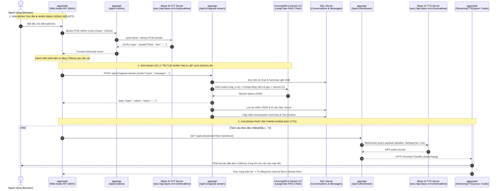
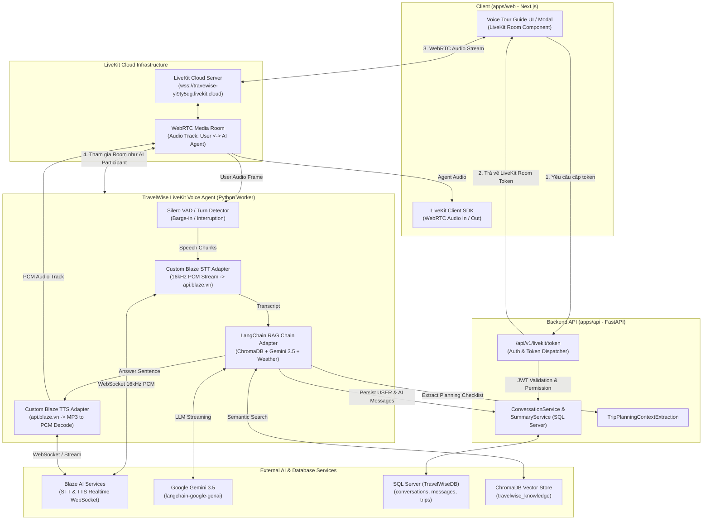

# Báo cáo Khảo sát Kiến trúc Voice & Thiết kế Tích hợp LiveKit — Giai đoạn 1

> **Dự án**: TravelWise AI (Monorepo: `apps/api`, `apps/web`)  
> **Tài liệu**: Khảo sát hiện trạng và kiến trúc mục tiêu tích hợp LiveKit Realtime Voice  
> **Trạng thái**: Hoàn thành Giai đoạn 1 (Khảo sát & Thiết kế kiến trúc — Chưa can thiệp code nghiệp vụ)  
> **Ngày thực hiện**: 24/10/2026  

---

## 1. Tổng quan Khảo sát Hệ thống Voice Hiện tại

TravelWise hiện sở hữu giải pháp đàm thoại giọng nói du lịch hai chiều (Voice Tour Guide) với tính năng nhận diện giọng nói (STT), truy xuất tri thức & lập kế hoạch du lịch (RAG & LLM), và tổng hợp âm thanh giọng đọc (TTS). 

Hệ thống hiện tại hoạt động theo cơ chế **Client-Orchestrated Pipelining** qua WebSocket và Server-Sent Events (SSE) độc lập:
1. **Frontend (`apps/web`)**: Trình duyệt trực tiếp quản lý pipeline Web Audio API (downsample 16kHz PCM), bộ đếm im lặng VAD (750ms), điều phối trạng thái đàm thoại (`idle` -> `listening` -> `thinking` -> `speaking`) và hàng đợi phát âm thanh song song (`StreamingTTSQueue`).
2. **Backend Proxy (`apps/api`)**: Cung cấp WebSocket proxy kết nối tới Blaze AI STT (`/api/v1/stt/ws`), luồng hỏi đáp SSE (`/api/v1/rag/ask-stream`), và luồng HTTP Chunked MP3 (`/api/v1/tts/stream`).

---

## 2. Sơ đồ Luồng Voice Hiện tại (As-Is Architecture)



---

## 3. Sơ đồ Kiến trúc Mục tiêu với LiveKit (To-Be Architecture)

Mục tiêu tích hợp LiveKit là chuyển đổi luồng đàm thoại từ cơ chế "nhiều kết nối rời rạc (HTTP SSE + HTTP Chunked TTS + WebSocket STT)" sang một **WebRTC Room thời gian thực duy nhất** với độ trễ tối thiểu (<500ms end-to-end), khả năng triệt tiêu tiếng vang (AEC) cấp độ viễn thông, kiểm soát ngắt lời người nói (barge-in / interruption handling) mượt mà, đồng thời bảo toàn 100% dữ liệu lịch sử hội thoại, lập lịch trình du lịch, GPS và cơ sở tri thức hiện có.



---

## 4. Danh mục File & Chức năng Liên quan

### 4.1. Phía Backend (`apps/api`)

| Đường dẫn file | Vai trò / Chức năng chính | Trạng thái LiveKit |
| :--- | :--- | :--- |
| [app/api/routes/stt.py](file:///e:/TravelWise/apps/api/app/api/routes/stt.py) | Định tuyến `GET /api/v1/stt/status` và `WebSocket /api/v1/stt/ws` proxy âm thanh từ trình duyệt tới Blaze STT. | **Bảo toàn** (dùng cho web client hiện tại / fallback). |
| [app/services/blaze_stt_service.py](file:///e:/TravelWise/apps/api/app/services/blaze_stt_service.py) | Service kết nối WebSocket tới `wss://api.blaze.vn/v1/stt/realtime`, gửi payload auth `token`, streaming PCM, phân tích transcript (`partial`/`final`). | **Tái sử dụng lõi** trong `BlazeSTTAdapter` của LiveKit Agent. |
| [app/api/routes/tts.py](file:///e:/TravelWise/apps/api/app/api/routes/tts.py) | Endpoint `GET /api/v1/tts/stream`, `POST /api/v1/tts`, `GET /api/v1/tts/status`. Stream trực tiếp file MP3 về client. | **Bảo toàn** (dùng cho Web Chat và preview âm thanh). |
| [app/services/tts_service.py](file:///e:/TravelWise/apps/api/app/services/tts_service.py) | `BlazeTTSService`: Quản lý in-memory audio cache, coalescing concurrent requests, WebSocket streaming kết nối `wss://api.blaze.vn/v1/tts/realtime`. | **Tái sử dụng lõi** trong `BlazeTTSAdapter` của LiveKit Agent. |
| [app/api/routes/rag.py](file:///e:/TravelWise/apps/api/app/api/routes/rag.py) | Endpoint `POST /api/v1/rag/ask` và `POST /api/v1/rag/ask-stream`. Lưu tin nhắn vào DB, kích hoạt trích xuất trip context, quản lý conversation summary. | **Tái sử dụng logic nghiệp vụ** khi agent hoàn tất câu trả lời. |
| [app/rag/chain.py](file:///e:/TravelWise/apps/api/app/rag/chain.py) | Lớp `RAGChain`: contextualize câu hỏi, truy xuất ChromaDB, định dạng prompt chuyên biệt cho voice (`get_rag_voice_prompt`), gọi LLM stream. | **Tái sử dụng trực tiếp 100%**. |
| [app/rag/llm.py](file:///e:/TravelWise/apps/api/app/rag/llm.py) | Factory khởi tạo `ChatGoogleGenerativeAI` (`GEMINI_MODEL`, `GEMINI_API_KEY`) hoặc OpenAI. | **Tái sử dụng trực tiếp 100%**. |
| [app/rag/prompt.py](file:///e:/TravelWise/apps/api/app/rag/prompt.py) | System prompt cho chế độ chat và voice (rút ngắn, loại bỏ markdown, cấu trúc tự nhiên cho đàm thoại). | **Tái sử dụng trực tiếp 100%**. |
| [app/services/conversation_service.py](file:///e:/TravelWise/apps/api/app/services/conversation_service.py) | Tạo cuộc trò chuyện (`create_conversation`), lưu tin nhắn (`save_message`), phân quyền người dùng (`get_conversation_by_id`). | **Tái sử dụng trực tiếp 100%**. |
| [app/services/conversation_summary_service.py](file:///e:/TravelWise/apps/api/app/services/conversation_summary_service.py) | Tóm tắt ngữ cảnh hội thoại đa phiên và lịch sử trao đổi. | **Tái sử dụng trực tiếp 100%**. |
| [app/services/trip_planning_service.py](file:///e:/TravelWise/apps/api/app/services/trip_planning_service.py) | `TripPlanningContextExtractionService`: Trích xuất checklist lập lịch trình (thời gian, số người, sở thích) từ tin nhắn voice. | **Tái sử dụng trực tiếp 100%**. |
| [app/core/config.py](file:///e:/TravelWise/apps/api/app/core/config.py) | Quản lý biến môi trường (`Settings`). Đã có sẵn trường cấu hình LiveKit Cloud (`LIVEKIT_URL`, `LIVEKIT_API_KEY`, `LIVEKIT_API_SECRET`). | **Bổ sung** các config cho LiveKit Agent room/identity nếu cần. |
| [apps/api/pyproject.toml](file:///e:/TravelWise/apps/api/pyproject.toml) | Quản lý dependencies backend. Đã có sẵn `livekit-api>=1.2.2`. | Cần thêm `livekit-agents` khi triển khai agent. |

### 4.2. Phía Frontend (`apps/web`)

| Đường dẫn file | Vai trò / Chức năng chính | Kế hoạch tích hợp LiveKit |
| :--- | :--- | :--- |
| [hooks/useSpeechToText.ts](file:///e:/TravelWise/apps/web/hooks/useSpeechToText.ts) | Hook ghi âm microphone, Web Audio API ScriptProcessor downsampling 16kHz PCM, kết nối WebSocket `/api/v1/stt/ws`. | **Giữ nguyên** cho chế độ hiện tại; LiveKit sử dụng WebRTC native audio track. |
| [services/tts.service.ts](file:///e:/TravelWise/apps/web/services/tts.service.ts) | Service phát TTS, quản lý `StreamingTTSQueue`, prefetch audio Blob cache, Web Speech API fallback. | **Giữ nguyên** cho text chat / playback; LiveKit phát trực tiếp qua WebRTC audio track. |
| [hooks/useVoiceCompanion.ts](file:///e:/TravelWise/apps/web/hooks/useVoiceCompanion.ts) | Điều phối trạng thái giọng nói (`VoiceState`), timer im lặng (750ms), gửi query tới `askStream`, tự động phát loa và nghe tiếp. | **Mở rộng / Bổ sung Hook song song** `useLiveKitVoiceCompanion.ts` hoặc tích hợp chế độ `engine="livekit" \| "websocket"`. |
| [components/chat/VoiceChatModal.tsx](file:///e:/TravelWise/apps/web/components/chat/VoiceChatModal.tsx) | Modal đàm thoại giọng nói trong trang chat `/chat`. | Hỗ trợ chuyển đổi liền mạch hoặc tích hợp LiveKit Room audio renderer. |
| [components/voice-guide/VoiceMicButton.tsx](file:///e:/TravelWise/apps/web/components/voice-guide/VoiceMicButton.tsx) | Nút micro hiệu ứng sóng âm động theo `VoiceState`. | **Tái sử dụng 100% UI** với state từ LiveKit room. |
| [components/chat/VoiceTourGuideBar.tsx](file:///e:/TravelWise/apps/web/components/chat/VoiceTourGuideBar.tsx) | Thanh điều khiển voice cố định phía dưới màn hình chat. | **Tái sử dụng 100% UI**. |
| [app/voice-guide/page.tsx](file:///e:/TravelWise/apps/web/app/voice-guide/page.tsx) | Trang chuyên biệt Trợ lý giọng nói Du lịch toàn màn hình. | Điểm kích hoạt trải nghiệm LiveKit Room chính. |
| [services/chat.service.ts](file:///e:/TravelWise/apps/web/services/chat.service.ts) | Gọi API `/api/v1/rag/ask-stream`, `/api/v1/rag/ask`, quản lý token Authorization. | Thêm hàm `getLiveKitToken(conversationId)` gọi backend. |

---

## 5. Bảng Phân Tích & Tương Thích Dịch Vụ Blaze AI

| Thuộc tính | Blaze AI Speech-to-Text (STT) | Blaze AI Text-to-Speech (TTS) |
| :--- | :--- | :--- |
| **Giao thức mạng** | WebSocket (`wss://`) & HTTP POST (fallback) | WebSocket (`wss://`) & HTTP GET/POST |
| **Endpoint URL** | `wss://api.blaze.vn/v1/stt/realtime`<br/>*(REST: `https://api.blaze.vn/v1/audio/transcriptions`)* | `wss://api.blaze.vn/v1/tts/realtime`<br/>*(REST: `https://api.blaze.vn/v1/tts`)* |
| **Model hiện tại** | `stt-stream-1.5` | `2.0-realtime` |
| **Xác thực (Authentication)** | Frame JSON đầu tiên: `{"token": BLAZE_API_KEY, "language": "vi", "model": "stt-stream-1.5"}`. Chờ server gửi `{"type": "ready"}`. | Frame JSON pipelining: `{"token": BLAZE_API_KEY, "strategy": "request"}` gửi kèm query frame. |
| **Định dạng dữ liệu đầu vào** | **Bắt buộc**: Raw Linear PCM 16-bit, Mono, Sample Rate **16,000 Hz**. | Text tiếng Việt thuần (sau khi clean markdown, emoji, HTML), độ dài < 5000 ký tự. |
| **Định dạng dữ liệu đầu ra** | JSON text: `{"type": "partial" \| "final", "text": "...", "is_final": bool}`. | Binary MP3 Audio frames, kết thúc bằng event JSON `{"type": "finished-byte-stream"}`. |
| **Cấu hình giọng & Tốc độ** | Mặc định ngôn ngữ `vi` | `speaker_id="DaNang-Nu-1-BL"`, `speed="1.5"`, `audio_quality=64`, `audio_format="mp3"` |
| **Khả năng Streaming** | Có (Realtime bi-directional streaming qua WebSocket). | Có (Server stream binary MP3 chunked response). |
| **Cơ chế LiveKit Adapter** | **Cần Custom STT Adapter**: Nhận WebRTC audio frames từ LiveKit (resample về 16kHz Mono PCM) -> Đẩy vào Blaze STT WebSocket -> Thu nhận text transcript phát ra sự kiện `SpeechEvent(type=FINAL_TRANSCRIPT)`. | **Cần Custom TTS Adapter**: Nhận văn bản câu từ LLM -> Đẩy vào Blaze TTS WebSocket/Stream -> Nhận các chunk MP3 -> Decode qua `PyAV` (`av.AudioResampler`) thành PCM frames chuẩn -> Đẩy vào LiveKit AudioSource. |
| **Mức độ xác minh** | **Đã xác minh qua code thực tế**: Code kết nối, gửi/nhận frame hoạt động trong `blaze_stt_service.py`. | **Đã xác minh qua code thực tế**: Code kết nối, nhận chunk MP3 và stream hoạt động trong `tts_service.py`. |

---

## 6. Cơ chế Xác Thực, Phân Quyền, CORS & Quản lý Dữ liệu

1. **Xác thực người dùng (Authentication & Authorization)**:
   - Hệ thống dùng JSON Web Token (JWT) mã hóa HS256 với secret `JWT_SECRET`.
   - Phụ thuộc `get_current_user_optional` trong [app/api/deps.py](file:///e:/TravelWise/apps/api/app/api/deps.py) cho phép cả người dùng vãng lai (`user_id = None`) và người dùng đã đăng nhập sử dụng tính năng voice.
   - Khi tạo Room LiveKit: Backend endpoint sẽ ký `AccessToken` của LiveKit (dùng `livekit-api`), nhúng thông tin `identity` (user ID hoặc guest UUID), `room_name` (ví dụ `travelwise_conv_{conversation_id}`), và metadata `conversation_id`.
2. **CORS Configuration**:
   - Trong [app/main.py](file:///e:/TravelWise/apps/api/app/main.py), CORS đã cấu hình cho phép các nguồn gốc từ frontend (`http://localhost:3000`). WebRTC media traffic đi thẳng tới LiveKit Cloud (`*.livekit.cloud`) nên không bị chặn bởi CORS của HTTP backend.
3. **Quản lý Hội thoại & Lịch sử**:
   - Bảng `conversations` và `messages` trong SQL Server quản lý mọi tin nhắn:
     - `sender = "USER"`: Lưu câu hỏi người dùng nói sau khi STT chốt câu.
     - `sender = "AI"`: Lưu câu trả lời tổng hợp từ RAG/Gemini.
   - Khi chuyển sang LiveKit: Toàn bộ tin nhắn sinh ra trong phiên LiveKit vẫn sẽ được gọi qua `ConversationService.save_message` và `TripPlanningContextExtractionService.extract_and_update_trip_context` để giao diện chat, lịch sử và Trip Canvas phía web tự động đồng bộ thời gian thực.

---

## 7. Đề xuất Kiến trúc Tích hợp LiveKit (Chi tiết)

### 7.1. Mô hình Phân chia Trách nhiệm (Separation of Concerns)

1. **LiveKit Cloud (`wss://travewise-yi9ty5dg.livekit.cloud`)**:
   - Đóng vai trò máy chủ trung chuyển WebRTC (SFU).
   - Đảm bảo kết nối âm thanh ổn định, mã hóa WebRTC, tự động thích ứng băng thông, triệt tiêu độ trễ mạng và mất gói.
2. **TravelWise FastAPI (`apps/api`)**:
   - Cung cấp REST endpoint mới: `POST /api/v1/livekit/token`.
   - Kiểm tra JWT người dùng, tìm hoặc tạo mới `conversation_id`.
   - Sử dụng `livekit-api` để sinh `AccessToken` kèm quyền `room_join`, `can_publish_audio`, `can_subscribe_audio`.
3. **LiveKit Agent Worker (Python)**:
   - Chạy như một worker process riêng biệt (hoặc module service song hành) kết nối vào LiveKit Cloud.
   - Sử dụng `livekit-agents` (đã kiểm tra tương thích Python 3.14).
   - Tích hợp 4 thành phần con:
     - **VAD**: Sử dụng VAD tích hợp của LiveKit (`Silero VAD`) để nhận diện chính xác thời điểm người dùng bắt đầu nói và kết thúc nói, kích hoạt khả năng dừng nói của AI ngay lập tức khi người dùng cướp lời (Barge-in).
     - **STT**: `BlazeSTTAdapter` đóng gói logic kết nối tới Blaze AI STT Realtime.
     - **LLM/RAG**: Tái sử dụng trực tiếp `RAGChain` (`app/rag/chain.py`) với `ChatGoogleGenerativeAI` (`GEMINI_MODEL`), giữ nguyên truy xuất ChromaDB và prompt voice.
     - **TTS**: `BlazeTTSAdapter` đóng gói `BlazeTTSService` (kết nối WebSocket hoặc stream), giải mã MP3 sang PCM 24kHz/48kHz đưa vào WebRTC Audio Track.
4. **TravelWise Web (`apps/web`)**:
   - Cài đặt `@livekit/components-react` và `livekit-client` (đã thử nghiệm tương thích hoàn toàn với React 19 và Next.js 16).
   - Tích hợp component đàm thoại giọng nói vào trang `/voice-guide` và `/chat`.
   - Giữ nguyên các chức năng Text Chat, Itinerary Canvas, Bản đồ MapLibre, GPS location.

---

## 8. Những gì Có Thể Dùng Trực Tiếp vs. Những gì Cần Adapter Tùy Chỉnh

| Thành phần | Dùng trực tiếp (Out-of-the-box) | Cần Adapter tùy chỉnh (Custom Adapter) | Ghi chú kỹ thuật |
| :--- | :---: | :---: | :--- |
| **LiveKit Server / Cloud** | ✅ | ❌ | Đã có tài khoản và URL Cloud: `wss://travewise-yi9ty5dg.livekit.cloud`. |
| **Token Dispatcher (`livekit-api`)** | ✅ | ❌ | Thư viện `livekit-api==1.2.2` đã cài trong `apps/api`. Chỉ cần viết endpoint sinh token. |
| **Frontend WebRTC Audio** | ✅ | ❌ | Dùng `LiveKitRoom`, `RoomAudioRenderer`, `useVoiceAssistant` từ `@livekit/components-react`. |
| **RAG Chain & Prompt** | ✅ | ❌ | Tái sử dụng `RAGChain.stream_answer` và `get_rag_voice_prompt` trong [app/rag/chain.py](file:///e:/TravelWise/apps/api/app/rag/chain.py). |
| **Database & Conversation History** | ✅ | ❌ | Tái sử dụng [ConversationService](file:///e:/TravelWise/apps/api/app/services/conversation_service.py) và [ConversationSummaryService](file:///e:/TravelWise/apps/api/app/services/conversation_summary_service.py). |
| **Weather & Trip Context** | ✅ | ❌ | Tái sử dụng [WeatherContextService](file:///e:/TravelWise/apps/api/app/services/weather_context_service.py) và [TripPlanningService](file:///e:/TravelWise/apps/api/app/services/trip_planning_service.py). |
| **Blaze STT Adapter** | ❌ | ⚠️ **Cần Adapter** | LiveKit chưa có plugin Blaze AI; cần tạo `BlazeSTTAdapter(livekit.agents.stt.STT)` chuyển đổi audio stream sang 16kHz PCM tới `api.blaze.vn`. |
| **Blaze TTS Adapter** | ❌ | ⚠️ **Cần Adapter** | Cần tạo `BlazeTTSAdapter(livekit.agents.tts.TTS)` gọi Blaze TTS và decode MP3 byte chunks thành PCM audio frames phát vào WebRTC room. |
| **Event Bridge** | ❌ | ⚠️ **Cần Adapter** | Cần module đồng bộ tin nhắn AI/User từ LiveKit Agent room về SQL Server và phát tín hiệu cho Web UI cập nhật màn hình. |

---

## 9. Rủi ro Kỹ thuật & Các Điểm Chưa Xác Minh

> [!WARNING]
> 1. **Chưa có thư viện chính thức của LiveKit cho Blaze AI**: Cần viết 2 adapter tùy biến cho STT và TTS kế thừa từ class chuẩn của `livekit-agents`.
> 2. **Giải mã MP3 sang PCM thời gian thực**: Blaze TTS trả về định dạng MP3 (hoặc wav tùy tham số). Để LiveKit stream audio mượt mà ra WebRTC track, worker cần giải mã MP3 sang PCM raw frames nhanh chóng (sử dụng thư viện `av` / PyAV đã có trong phụ thuộc của `livekit-agents`).
> 3. **Chưa có tài liệu chính thức về Word-level Timestamps của Blaze STT**: Hiện tại Blaze AI chỉ trả về text transcript từng phần hoặc chốt câu, chưa có timestamp từng từ. Điều này không ảnh hưởng đến việc nhận dạng, nhưng cần lưu ý nếu muốn hiển thị highlight chữ chạy theo giọng nói.
> 4. **Bảo toàn chức năng cũ**: Tuyệt đối không xóa endpoint WebSocket `/api/v1/stt/ws` và `/api/v1/tts/stream` để đảm bảo các tính năng cũ (như modal chat hiện tại) luôn hoạt động ổn định.

---

## 10. Kế Hoạch Triển Khai Theo Từng Giai Đoạn

```mermaid
gantt
    title Kế hoạch Triển khai Tích hợp LiveKit cho TravelWise AI
    dateFormat  X
    axisFormat  Giai đoạn %s

    section Lập kế hoạch
    Giai đoạn 1: Khảo sát & Thiết kế kiến trúc (Hoàn tất) :active, p1, 0, 1
    
    section Backend & Agent
    Giai đoạn 2: Cấp Token LiveKit & Cấu hình Worker       :p2, 1, 2
    Giai đoạn 3: Xây dựng Blaze STT & TTS Custom Adapters :p3, 2, 3
    Giai đoạn 4: Tích hợp RAG Chain, Gemini & Memory      :p4, 3, 4
    
    section Frontend & Tích hợp
    Giai đoạn 5: Tích hợp LiveKit Client vào Next.js      :p5, 4, 5
    Giai đoạn 6: Kiểm thử toàn diện, Đo độ trễ & Nghiệm thu:p6, 5, 6
```

- **Giai đoạn 1 (Hiện tại)**: Khảo sát mã nguồn, truy vết toàn bộ luồng voice hiện tại, lập báo cáo chi tiết và sơ đồ kiến trúc mục tiêu. *(Hoàn thành)*
- **Giai đoạn 2**: Xây dựng endpoint cấp Token LiveKit tại FastAPI (`/api/v1/livekit/token`), thiết lập cấu hình môi trường chuẩn và khung Agent Worker.
- **Giai đoạn 3**: Triển khai `BlazeSTTAdapter` và `BlazeTTSAdapter` cho LiveKit Agent, giải mã âm thanh và kiểm thử riêng rẽ với máy chủ Blaze AI.
- **Giai đoạn 4**: Ghép nối Agent với `RAGChain`, Gemini 3.5, ChromaDB, SQL Server conversation persistence và lập lịch trình.
- **Giai đoạn 5**: Triển khai giao diện client LiveKit trên `apps/web` (React 19 / Next.js 16), kết nối WebRTC hai chiều và kiểm tra trạng thái tương tác trên UI.
- **Giai đoạn 6**: Kiểm thử toàn diện: độ trễ đàm thoại (end-to-end latency), tính năng ngắt lời (barge-in), lưu tin nhắn, kiểm tra hồi quy toàn bộ chức năng cũ.

---

*Báo cáo được hoàn thành theo đúng nguyên tắc khảo sát của Giai đoạn 1, không thay đổi bất kỳ logic code hay dữ liệu hệ thống nào.*
