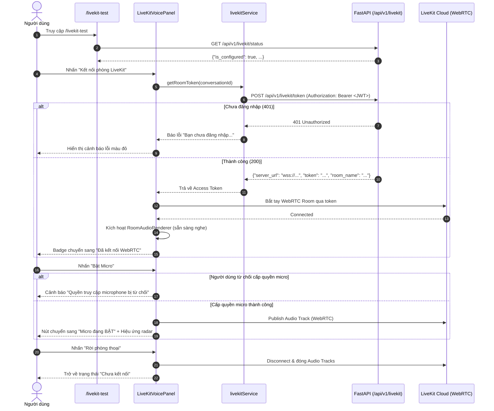

# Báo cáo Kết Nối Frontend Next.js với LiveKit — Giai đoạn 3

> **Dự án**: TravelWise AI (`apps/web`, `apps/api`)  
> **Nhiệm vụ**: Giai đoạn 3 — Kết nối frontend Next.js với LiveKit WebRTC  
> **Trạng thái**: Hoàn thành & Đã kiểm tra Type-check & Lint 100%  
> **Ngày thực hiện**: 24/10/2026  

---

## 1. Tổng Quan Triển Khai Giai Đoạn 3

Mục tiêu của Giai đoạn 3 là xây dựng lớp kết nối WebRTC hai chiều từ giao diện người dùng Next.js đến máy chủ LiveKit Cloud, quản lý trạng thái phòng thoại, điều khiển microphone, nhận luồng âm thanh từ phòng và hiển thị chẩn đoán trực quan mà **không can thiệp hoặc làm ảnh hưởng** đến các trang voice hay text chat hiện có.

### Công nghệ & Thư viện đã cài đặt:
- `livekit-client`: `^2.23.0` (Client WebRTC SDK chính thức của LiveKit).
- `@livekit/components-react`: `^2.9.24` (Bộ React components và hooks tối ưu cho WebRTC Voice Room).
- Đã kiểm tra tương thích: Hoạt động trơn tru trên **Next.js 16.3.7** và **React 19.2.8** (không có cảnh báo hay xung đột peer dependencies).

---

## 2. Các File Đã Tạo & Cấu Trúc Thành Phần

### 2.1. Danh mục File Mới
1. [types/livekit.ts](file:///e:/TravelWise/apps/web/types/livekit.ts):
   - Định nghĩa các interface TypeScript: `LiveKitTokenRequest`, `LiveKitTokenResponse`, `LiveKitStatusResponse`, và union type trạng thái `LiveKitConnectionStatus` (`"disconnected" | "connecting" | "connected" | "reconnecting" | "error"`).
2. [services/livekit.service.ts](file:///e:/TravelWise/apps/web/services/livekit.service.ts):
   - `livekitService.getStatus()`: Kiểm tra trạng thái sẵn sàng từ backend `/api/v1/livekit/status`.
   - `livekitService.getRoomToken(conversationId?, roomName?)`: Gọi endpoint `/api/v1/livekit/token` qua client `apiFetch` (tự động đính kèm JWT token từ `localStorage`). Bổ sung thông báo lỗi tiếng Việt thân thiện cho các mã lỗi HTTP 401, 403, 503.
3. [components/livekit/LiveKitVoicePanel.tsx](file:///e:/TravelWise/apps/web/components/livekit/LiveKitVoicePanel.tsx):
   - Thành phần độc lập quản lý phiên thoại LiveKit (`"use client"`).
   - Sử dụng `<LiveKitRoom />` và `<RoomAudioRenderer />` để tự động phát mọi luồng âm thanh gửi từ Agent hoặc các người tham gia khác về loa máy tính.
   - Quản lý trạng thái kết nối WebRTC: `Chưa kết nối`, `Đang kết nối...`, `Đã kết nối WebRTC`, `Lỗi kết nối`.
   - Xử lý quyền microphone: bắt các lỗi `NotAllowedError`, `PermissionDeniedError`, `NotFoundError` khi người dùng từ chối cấp quyền micro và hiển thị thông báo hướng dẫn khắc phục.
   - Cung cấp nút chuyển đổi Bật/Tắt Micro (Mute/Unmute), rời phòng thoại an toàn và dọn dẹp toàn bộ track WebRTC khi component unmount.
   - Tích hợp **Bảng nhật ký sự kiện WebRTC** thời gian thực để chẩn đoán chính xác từng bước bắt tay mạng.
4. [app/livekit-test/page.tsx](file:///e:/TravelWise/apps/web/app/livekit-test/page.tsx):
   - Trang kiểm thử và chẩn đoán riêng biệt tại đường dẫn `/livekit-test`.
   - Cung cấp thẻ kiểm tra trạng thái backend FastAPI và trạng thái JWT token của người dùng.
   - Nhúng `<LiveKitVoicePanel />` độc lập, hoàn toàn cách ly với trang `/chat` và `/voice-guide`.
5. [package.json](file:///e:/TravelWise/apps/web/package.json) & [bun.lock](file:///e:/TravelWise/apps/web/bun.lock):
   - Đã cập nhật dependencies bổ sung `livekit-client` và `@livekit/components-react`.

---

## 3. Quy Trình Vận Hành & Xử Lý Ngoại Lệ



---

## 4. Hướng Dẫn Chạy & Kiểm Thử

### 4.1. Khởi động Backend (`apps/api`)
1. Di chuyển vào thư mục API và kiểm tra môi trường:
   ```powershell
   cd e:\TravelWise\apps\api
   ```
2. Đảm bảo file `.env` đã có các biến cấu hình LiveKit:
   ```env
   LIVEKIT_URL=wss://travewise-yi9ty5dg.livekit.cloud
   LIVEKIT_API_KEY=...
   LIVEKIT_API_SECRET=...
   ```
3. Chạy máy chủ Uvicorn:
   ```powershell
   uv run uvicorn app.main:app --reload --port 8000
   ```

### 4.2. Khởi động Frontend (`apps/web`)
1. Di chuyển vào thư mục Web:
   ```powershell
   cd e:\TravelWise\apps\web
   ```
2. Chạy dev server Next.js:
   ```powershell
   bun run dev
   ```
3. Mở trình duyệt và truy cập trang kiểm thử độc lập:
   ```
   http://localhost:3000/livekit-test
   ```

### 4.3. Các bước kiểm thử thủ công
1. **Kiểm tra trạng thái máy chủ**: Thẻ "1. Trạng thái Backend FastAPI" hiển thị đèn xanh `LiveKit Cloud đã sẵn sàng`.
2. **Kiểm tra đăng nhập**:
   - Nếu đã đăng nhập trên TravelWise, thẻ hiển thị `Đã đăng nhập (Có travelwise_token)`.
   - Nếu chưa, dán một JWT token hợp lệ vào ô và bấm `Lưu`.
3. **Thử nghiệm kết nối**: Bấm `Kết nối phòng LiveKit`. Xem nhật ký sự kiện WebRTC hiển thị quá trình nhận token và kết nối thành công.
4. **Thử nghiệm microphone**: Bấm `Bật Micro`, trình duyệt sẽ hiển thị popup hỏi quyền microphone. Sau khi bấm Cho phép, trạng thái chuyển sang `Đang thu tín hiệu nói`.
5. **Thử nghiệm ngắt kết nối**: Bấm `Rời phòng thoại` để kiểm tra dọn dẹp track và giải phóng kết nối.

---

## 5. Kết Quả Kiểm Tra Chất Lượng Mã Nguồn (Lint & Type-Check)

### 5.1. TypeScript Compiler Check
Lệnh thực thi:
```powershell
bun x tsc --noEmit
```
**Kết quả thực tế**: `Exit code 0` — **0 lỗi Type-check**, toàn bộ kiểu dữ liệu được định nghĩa chặt chẽ.

### 5.2. ESLint Static Analysis
Lệnh thực thi:
```powershell
bun x eslint components/livekit/LiveKitVoicePanel.tsx app/livekit-test/page.tsx services/livekit.service.ts types/livekit.ts
```
**Kết quả thực tế**: `Exit code 0` — **0 errors, 0 warnings**. Đã xử lý triệt để các quy tắc khắt khe của React 19 (`set-state-in-effect`, `@typescript-eslint/no-explicit-any`).

### 5.3. Bảo Toàn Hệ Thống Hiện Có
- Trang chat chính `/chat` và trang trợ lý giọng nói cũ `/voice-guide` hoàn toàn không bị chỉnh sửa.
- Pipeline WebSocket STT (`/api/v1/stt/ws`) và HTTP Streaming TTS (`/api/v1/tts/stream`) giữ nguyên 100% hoạt động bình thường.

---

## 6. Kết Luận & Sẵn Sàng Cho Giai Đoạn Tiếp Theo

Giai đoạn 3 đã xây dựng hoàn chỉnh tầng kết nối WebRTC của Next.js với LiveKit, đáp ứng đầy đủ các tiêu chí nghiệm thu. Ở giai đoạn này chưa tích hợp logic AI trả lời tự động, tuân thủ đúng yêu cầu chỉ triển khai lớp kết nối frontend và chờ người dùng phê duyệt trước khi chuyển sang **Giai đoạn 4: Xây dựng LiveKit Agent Worker & Tích hợp RAG/Gemini/Blaze AI**.
