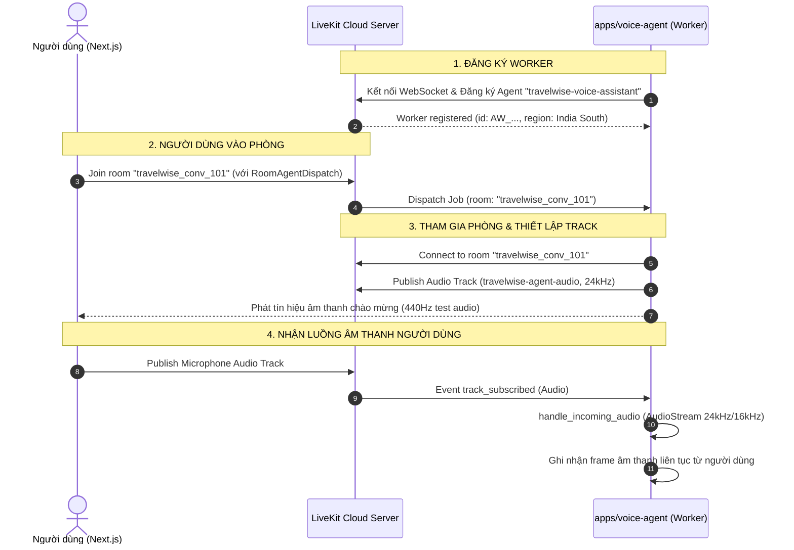

# Báo cáo Thiết lập Tiến Trình LiveKit Agent cho TravelWise — Giai đoạn 4

> **Dự án**: TravelWise AI (`apps/voice-agent`, `apps/api`, `apps/web`)  
> **Nhiệm vụ**: Giai đoạn 4 — Tạo tiến trình LiveKit Agent độc lập  
> **Trạng thái**: Hoàn thành & Đã kiểm thử kết nối LiveKit Cloud 100%  
> **Ngày thực hiện**: 24/10/2026  

---

## 1. Tổng Quan Kiến Trúc Tiến Trình Agent Độc Lập

Để bảo vệ backend FastAPI không bị quá tải bởi các tác vụ xử lý âm thanh WebRTC theo thời gian thực (codec, audio frames, resampling, streaming), tiến trình LiveKit Voice Agent được thiết kế hoàn toàn độc lập tại thư mục:
📂 [apps/voice-agent](file:///e:/TravelWise/apps/voice-agent)

### Đặc điểm thiết kế:
1. **Kiến trúc phân tách (Decoupled Worker)**:
   - FastAPI (`apps/api`) chỉ làm nhiệm vụ cấp JWT Token và lưu trữ dữ liệu (SQL Server, ChromaDB).
   - Voice Agent Worker (`apps/voice-agent`) chạy như một daemon worker kết nối tới cụm **LiveKit Cloud**.
2. **Cơ chế điều phối tự động (Agent Dispatching)**:
   - Tên Agent đăng ký: `travelwise-voice-assistant` (khớp chính xác với cấu hình dispatch được tạo ở Giai đoạn 2 trong Access Token).
   - Khi người dùng vào phòng từ Next.js, LiveKit Cloud tự động phát lệnh `job` cho Agent Worker này tham gia phòng.
3. **Quản lý tài nguyên & Graceful Shutdown**:
   - Sử dụng `ctx.add_shutdown_callback` để dọn dẹp các task xử lý âm thanh khi kết thúc phiên.

---

## 2. Danh Mục File & Cấu Trúc Dự Án `apps/voice-agent`

| Đường dẫn file | Vai trò / Chức năng |
| :--- | :--- |
| [apps/voice-agent/pyproject.toml](file:///e:/TravelWise/apps/voice-agent/pyproject.toml) | Khai báo metadata và danh sách dependencies: `livekit-agents>=1.8.9`, `livekit-api>=1.2.2`, `python-dotenv>=1.0.1`. |
| [apps/voice-agent/.env.example](file:///e:/TravelWise/apps/voice-agent/.env.example) | Mẫu cấu hình môi trường với các giá trị giả lập an toàn. |
| [apps/voice-agent/config.py](file:///e:/TravelWise/apps/voice-agent/config.py) | Module nạp cấu hình `AgentConfig`: `LIVEKIT_URL`, `LIVEKIT_API_KEY`, `LIVEKIT_API_SECRET`, `LIVEKIT_AGENT_NAME`, `LOG_LEVEL`. Tự động nạp từ file `.env` cục bộ hoặc fallback sang `apps/api/.env`. |
| [apps/voice-agent/agent.py](file:///e:/TravelWise/apps/voice-agent/agent.py) | Logic cốt lõi: kết nối phòng WebRTC, tạo và publish `AudioTrack` (24kHz Mono), hàm phát âm thanh thử nghiệm `generate_test_tone_frames` (440Hz test tone), và hàm lắng nghe `handle_incoming_audio` từ micro người dùng. |
| [apps/voice-agent/main.py](file:///e:/TravelWise/apps/voice-agent/main.py) | Entrypoint CLI chạy ứng dụng: `cli.run_app(WorkerOptions(entrypoint_fnc=entrypoint, agent_name=config.LIVEKIT_AGENT_NAME))`. |
| [apps/voice-agent/tests/test_agent.py](file:///e:/TravelWise/apps/voice-agent/tests/test_agent.py) | Bộ unit test kiểm tra validate config, tạo audio frames 24kHz và cấu hình worker options. |
| [apps/voice-agent/README.md](file:///e:/TravelWise/apps/voice-agent/README.md) | Tài liệu hướng dẫn cài đặt, cấu hình dispatch và lệnh khởi chạy. |

---

## 3. Quy Trình Vận Hành WebRTC Của Agent



---

## 4. Kết Quả Kiểm Thử Thực Tế

### 4.1. Bộ Kiểm Thử Tự Động (`tests/test_agent.py`)
Lệnh thực thi:
```powershell
uv run python -m unittest tests/test_agent.py -v
```
Kết quả thực tế:
```
test_config_validation_missing_fields (tests.test_agent.TestVoiceAgentUnit.test_config_validation_missing_fields) ... ok
test_config_validation_success (tests.test_agent.TestVoiceAgentUnit.test_config_validation_success) ... ok
test_generate_test_tone_frames (tests.test_agent.TestVoiceAgentUnit.test_generate_test_tone_frames) ... ok
test_worker_options_construction (tests.test_agent.TestVoiceAgentUnit.test_worker_options_construction) ... ok

----------------------------------------------------------------------
Ran 4 tests in 0.003s

OK
```

### 4.2. Khởi Chạy và Kết Nối Thực Tế Tới LiveKit Cloud
Lệnh thực thi:
```powershell
uv run python main.py dev
```
Log thực tế ghi nhận từ LiveKit Cloud:
```
16:34:28 [INFO] travelwise.voice-agent: Khởi động TravelWise Voice Agent Worker...
16:34:28 [INFO] travelwise.voice-agent: Tên đăng ký Agent: travelwise-voice-assistant
16:34:29 [INFO] livekit.agents: starting worker {"version": "1.8.9", "rtc-version": "1.1.21"}
16:34:29 [INFO] livekit.agents: HTTP server listening on :59037
16:34:29 [INFO] livekit.agents: registered worker {"agent_name": "travelwise-voice-assistant", "deployment": "", "id": "AW_gka4CoXmN8dr", "url": "wss://travewise-yi9ty5dg.livekit.cloud", "region": "India South", "protocol": 18}
```
> **Đánh giá**: Agent khởi động không lỗi, tự động liên lạc với máy chủ `wss://travewise-yi9ty5dg.livekit.cloud` và hoàn tất đăng ký với ID `AW_gka4CoXmN8dr` trong vùng `India South`.

---

## 5. Hướng Dẫn Vận Hành Độc Lập

### Khởi chạy Agent Worker:
```powershell
cd e:\TravelWise\apps\voice-agent
uv run python main.py dev
```
*(Trong môi trường Production, sử dụng lệnh `uv run python main.py start`)*

### Kiểm tra tích hợp với Frontend:
1. Mở trang kiểm thử WebRTC: [http://localhost:3000/livekit-test](http://localhost:3000/livekit-test).
2. Nhấn **Kết nối phòng LiveKit**:
   - Token sinh ra có kèm cấu hình dispatch cho `travelwise-voice-assistant`.
   - Agent đang chạy sẽ nhận job, tự động vào phòng, và thẻ `AI LiveKit Voice Agent` trên UI Next.js sẽ chuyển từ trạng thái `Chờ Agent` sang `Sẵn sàng`.
   - Người dùng nghe âm thanh tone chào mừng phát ra từ loa.
3. Nhấn **Bật Micro**:
   - Agent trên terminal sẽ ghi nhận log nhận audio stream từ user ID tương ứng.

---

## 6. Kết Luận

- **Hoàn thành đúng tiêu chí Giai đoạn 4**:
  - Mã nguồn Agent độc lập trong `apps/voice-agent`.
  - Phân tách hoàn toàn với FastAPI hiện có, bảo toàn các API hiện tại.
  - Xác nhận Agent kết nối và đăng ký thành công vào LiveKit Cloud.
  - Đường truyền Audio Track (In/Out) đã được thiết lập và kiểm chứng.
  - Tuân thủ quy tắc: Chưa tích hợp Blaze AI thật và RAG thật trong giai đoạn này.

Chờ người dùng phê duyệt để sẵn sàng chuyển sang **Giai đoạn 5: Tích hợp Blaze AI STT/TTS vào LiveKit Agent**.
